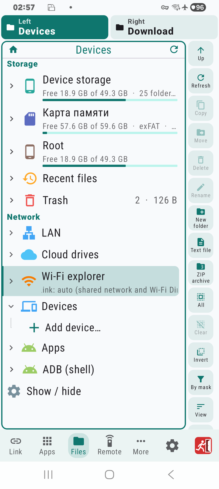
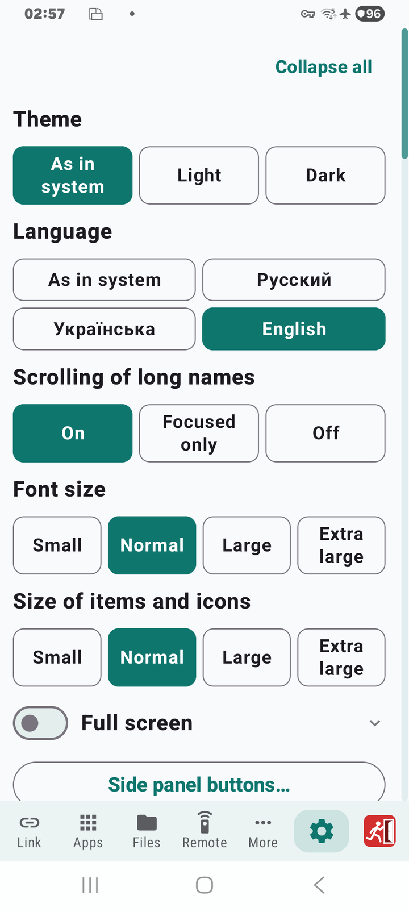
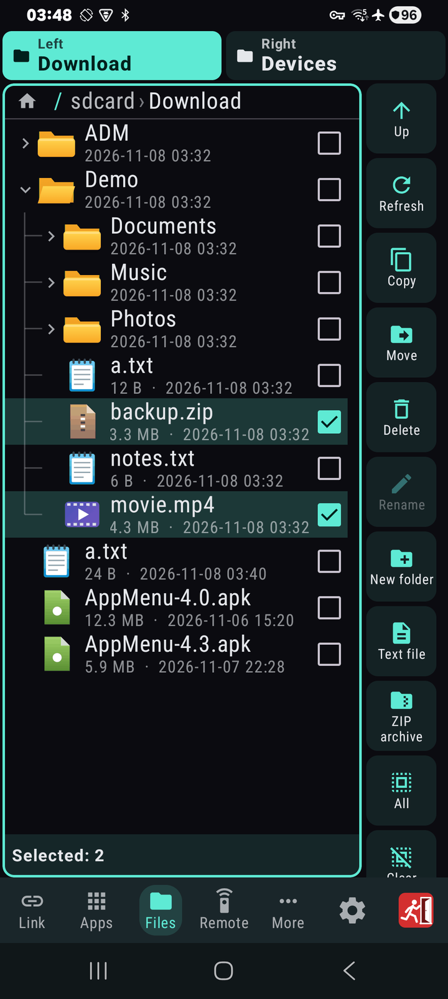
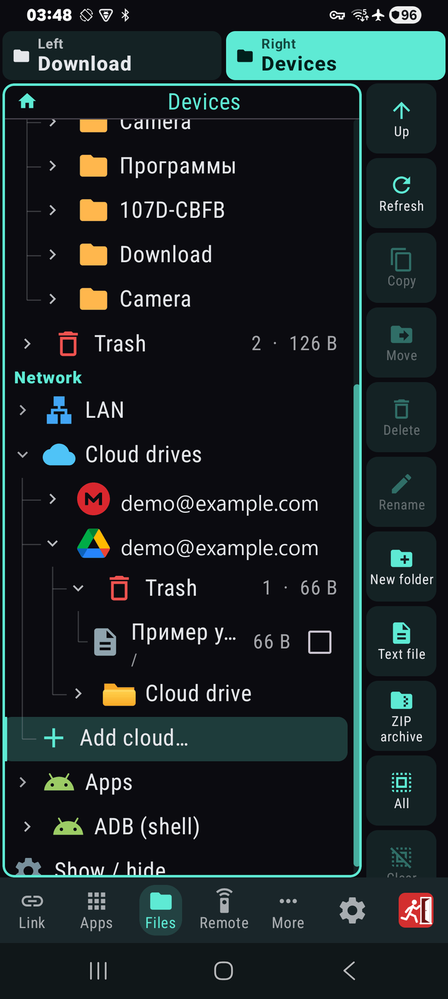
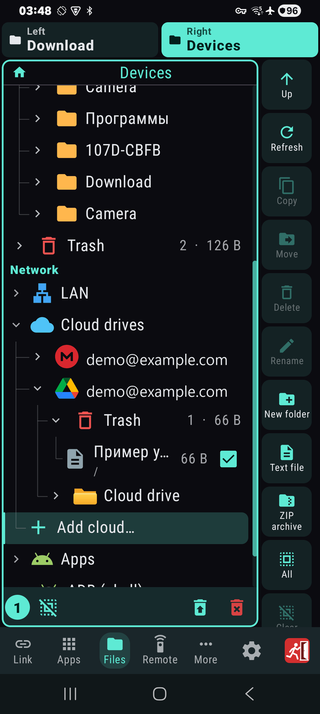
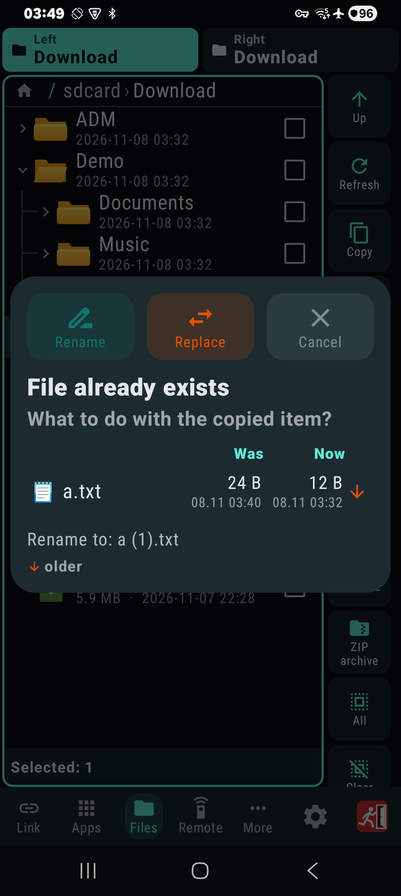
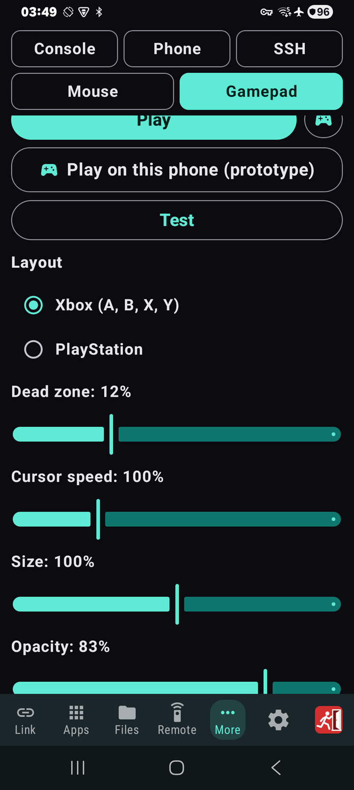
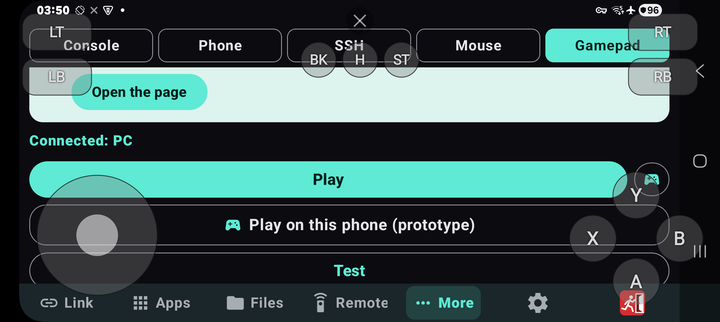
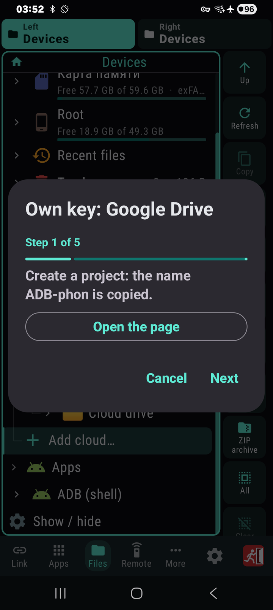
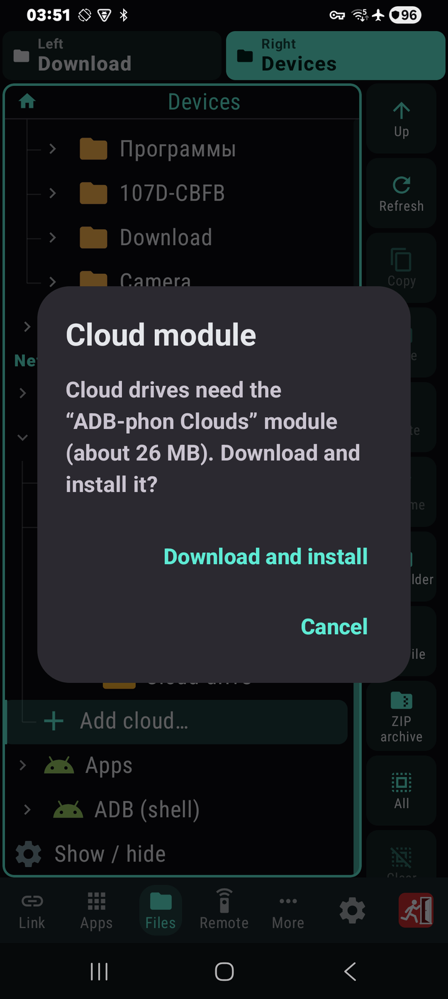

[English](README.md) · [Русский](README.ru.md) · [Українська](README.uk.md)

🌐 All our programs: https://drugoj00.github.io/

📖 Full user guide for every feature: [INSTRUCTION.md](INSTRUCTION.md)

# ADB-phon

Free ADB manager right on your phone: install APKs over ADB, air mouse and remote control, special access that survives a reboot. No computer needed, root is optional (with root even ADB is not needed).

ADB-phon connects to the ADB of the same phone (or of another device in your network) and runs commands with shell rights, as if the phone were plugged into a computer.

⭐ If the app is useful, please star this repository: it costs nothing and helps others find it.

## Download

**Version 7.5.** [ADB-phon-7.5.apk](https://github.com/drugoj00/adb-phon/releases/latest) (Assets) · [Releases](https://github.com/drugoj00/adb-phon/releases)

SHA-256: `0f4676c3f0df9387c80bf24d7a6ce2833cf4b5abcffa790989d692efd321d978`

## What's new in 7.5

- Color settings: “Main color” and “Bar color” as a color bar with the “Like the theme” button. “Bar contrast” from the previous look to a fully transparent free part
- “Install” window after choosing ADB-phon: icon, name, package, kind (new, update, same version, downgrade), a “Now / New” table with highlighted differences, added and removed permissions
- Different signature: a warning, the install is not attempted
- Install progress bar by bytes and by files, a summary and failure reasons
- Downgrade: without root on Android 14 and newer with data removal (a copy of the current version, rollback on failure), with root with data kept; system apps cannot be downgraded
- Long name scrolling: “On” and “Off”
- Files side panel buttons: larger icons, rearranging by long press, on a remote by holding OK and arrow keys
- Files: list position and focus are remembered

## Features

- **Install APK over ADB.** Install or update apps through ADB, no computer needed. Sources: a file, a folder, an archive (ZIP, 7z, RAR, TAR), the built-in file manager (including USB drives through ADB), network folders (SMB), files sent over Wi-Fi from a browser, search on the internet (F-Droid, GitHub, a link). Multi-part packages APKS, APKM, XAPK and ZIP with APK and OBB: the parts for your phone are picked automatically. Batch install.
- **Air mouse and mouse.** The phone’s gyroscope works as a pointer. A real cursor appears on the screen of the controlled device (a helper creates a virtual mouse). The “Air” button works in two modes picked with a round switch: tap to turn on and tap again to turn off, or hold it while you move the phone. Click, scroll, OK, Back, Home, Menu, arrows, volume, sound and microphone on/off. Touch mode is instant too: the helper injects real touches, so taps and swipes work even on slow TV boxes.
- **Special access, survives reboot.** Turn on an accessibility service, keep it enabled after a reboot (Android 13–14 often switch it off), remove “restricted settings”, allow writing secure settings, draw over other apps, notifications, usage stats, all files, install unknown apps, no battery limits.
- **Remote control.** Four switchable modes: Keys, Swipe, Mouse, Air. Home, Back, Menu, D-pad and OK, volume, media keys, power, recents, text input. Swipes act as arrow keys, tap is OK, scroll buttons. Keys are instant. For phones, TVs and set-top boxes.
- **SSH.** Connect to a computer or server over SSH (Linux, macOS, Windows with an SSH server): terminal and files over SFTP (browse, download, upload, delete). Login with a password or a key file; the server key is remembered on first connect.
- **PC mouse.** The phone works as a Bluetooth mouse and keyboard for a computer, laptop, tablet, iPhone or TV (Android 9+): touch pad, clicks, scroll, Enter, Esc, arrows, Win, Ctrl+C/V, text input. Nothing to install on the computer.
- **Easy connection.** Finds devices in the network and shows their names, favourites with your own names, manual IP. Android 11+: automatic pairing without typing a code (an accessibility service reads the code from the system window) or pairing by code. Android 8–10: one command from a computer once, then the app connects by itself. Control another device by IP; press and hold a device to disconnect.
- **Apps.** Icons, search, filters (user, system, junk, disabled, removed), disable and enable, uninstall and restore, stop, clear data, save APK, permission switches, batch actions (including batch uninstall), protection of critical packages, “Clean RAM” button.
- **Cleaner for junk apps.** The “Junk” filter shows well-known unneeded system apps (Samsung, Google, Microsoft, Facebook services, partner apps) with marks “safe” and “careful”. “Select safe” and disable them; it is reversible (Disabled, then Enable).
- **Copies and versions.** Before an app is uninstalled its APK is saved. The “Versions” button installs any version, including an older one, from saved copies, from F-Droid or from your own file.
- **Backup with data.** A copy of any app together with its data, and restore. With root all data is saved; over ADB only what the system allows (external data and, for apps that allow it, internal data on Android 10 and older). The program taps the system confirmation window itself.
- **Safe launcher disabling.** The only home screen cannot be disabled or deleted by mistake: if there is no spare one, the program offers to download App Menu from GitHub and installs it in one tap (internet needed).
- **Updates.** Checks GitHub for a new version on request and offers to update in one tap; in Settings you can switch on an automatic check once a day (off by default).
- **Files.** Two-panel file manager: phone memory, memory card, USB drives, archives (ZIP, 7z, RAR, TAR), Android/data over ADB, network folders and cloud drives in one tree. Create, rename, copy, move, delete, ZIP, text files, built-in editor, selection by mask, drag and drop between panels, a recycle bin for the phone, card, clouds and network folders, and a “File already exists” window (Rename, Replace, Cancel, Apply to all). After a restart folders and places come back.
- **Cloud drives.** Google Drive, MEGA, Dropbox, OneDrive, Yandex Disk, Box, pCloud and dozens of other services. Clouds work through a separate free module, “ADB-phon Clouds”, offered for download once when you add a cloud; the downloaded file deletes itself after installation. You sign in in the browser; if the shared key of the app is busy, the “Own key” wizard walks you through creating your own key, step by step.
- **Network folders.** SMB, SFTP, FTP, FTPS and WebDAV: browse, copy and move in both directions, also directly between two network sources or from a cloud to the network. A file is written safely: the original survives a failure or cancel.
- **Gamepad.** The phone as a gamepad for a PC over Bluetooth (vibration from the PC) and an on-screen gamepad, “Play on this phone” (prototype): sticks, A/B/X/Y, triggers, Back, Guide and Start over any game; layout, dead zone, size and transparency can be changed.
- **Phone.** Device info, monitor, screenshot, screen recording, clear all caches, quick settings (dark mode, Wi-Fi, data, Bluetooth, rotation, font, screen timeout, show touches, animations, DPI), reboot (normal, recovery, bootloader).
- **Devices and Video window.** The Files tree has one “Devices” group: computers and Android devices together, each with Files and Video window folders. Video window shows and controls the screen of a computer or another Android device: auto-rotation, text input in any language.
- **Video call.** Video call between Android devices and computers (the Windows program “Phone in Window with Sound” 3.0). How to call: open Connection → Video calls, tap “Add person…”, enter a name and the code of their program (XXXX-XXXX-XXXX; it is shown in the other program: on Windows in “Connection over the internet”, on Android in this same section), then tap “Call”. The other person sees the “Calling…” window; the camera and microphone turn on only when they tap “Answer”. During the call: Sound, Speaker, Camera, End. Receiving calls is on by default (a small icon in the notification shade); the switch is in the same section.
- **Invitations.** Join a Tailscale network by an invitation from a PC. Another VPN is turned off for the duration of a session and restored afterwards.
- **Shizuku compatibility.** Apps that support Shizuku get shell permissions through ADB-phon.
- **Console.** Live terminal: any shell command, history, Ctrl+C, Tab, “My commands”.
- **Settings.** Theme (auto, light, dark), dynamic colors from the wallpaper and the main color, font size and element size, full screen mode, color settings (main color, bar color, bar contrast), custom icons for folders, files, drives, apps and side panel buttons, language (English, Ukrainian, Russian), keep screen on, bug log, backup and restore of settings to a folder you choose, install any version of the program from GitHub.
- **Free.** No ads, open source.

## Screenshots

## Videos

- [Gamepad: Android to Android (Asphalt 9)](https://youtu.be/V30zZv2MmFM)
- [Gamepad: Android to PC (GTA 5)](https://youtu.be/OmIT5jgrWFw)

## Quick start

1. Download ADB-phon-7.0.apk and install it (allow installing from this source if Android asks).
2. Android 11 and newer: Settings, Developer options, turn on “Wireless debugging”, tap “Pair device with pairing code”. Open ADB-phon in split screen or a floating window, enter the port and the code, tap “Pair”, then “Connect”.
3. Android 8–10: once, from a computer with USB debugging, run adb tcpip 5555. In ADB-phon tap “Connect” and allow debugging on the phone.
4. For another device (TV, second phone) tap it in the “Devices in the network” list or type its IP.

## Requirements

Android 8.0 or newer (ARMv7, ARM64, x86, x86_64). Wi-Fi for wireless debugging (Android 11+). Android 8–10: one command from a computer once (adb tcpip 5555), repeated after a reboot. Tested on Android 10 (Samsung A7, S9), Android 15 (Samsung A14) and on TV boxes with Android 9, 11 and 12. Root in the file manager: with root (su) everything opens and permissions can be changed; through ADB without root only /system, Android/data and /data/local/tmp are open, while /data and permissions of files owned by others stay closed by Android itself.

## Limitations and warnings

- Actions on system apps can break the phone: be careful, the app asks for confirmation and protects critical packages.
- ADB-phon works locally and sends nothing anywhere. The cursor helper and the remote control manage a whole device: connect only to your own devices.
- The app is not on Google Play (it would not be allowed): download the APK here. Android may warn about installing from an unknown source.
- Tested on three phones (Android 10 and 15) and TV boxes (Android 9, 11, 12). Not yet tested on Android 8 and on x86 devices; reports are welcome.
- Cloud drives need the separate module “ADB-phon Clouds” (one download, internet needed). Google Drive: the app’s shared key is a trial one (first 100 users); then create your own key in the app. RAR5 archives are supported (also with a password). FTPS: browsing and downloading are tested, uploading only partly.
- SSH and “PC mouse” are new and tested only partly: SSH against OpenSSH for Windows up to the password step, the Bluetooth mouse is not on every phone (some firmwares switch the HID profile off).
- Special access settings can differ on Xiaomi, Huawei and other firmwares; on Xiaomi also turn on “USB debugging (security settings)”.
- Video window at a Tailscale address (100.x) works when both devices are in the Tailscale network (with another permanent VPN on the phone, use the address of that network). Text input in the Video window in any layout needs ADB-phon 7.0 or newer on the target device.

## Built with

Kotlin and Jetpack Compose; ADB client libadb-android (MuntashirAkon, GPL-3.0 or Apache-2.0) and Conscrypt (Apache-2.0). The app is independent and not related to Google. Licensed under GPL-3.0.

## News and help

- Telegram: [t.me/PhoneInWindowSound](https://t.me/PhoneInWindowSound)

## Support the project

The app is free. If it is useful you can support its development by card, Google Pay or USDT. For USDT use only the TRON network (TRC20): coins sent over another network are lost.

- By card or Google Pay (from 50 UAH): https://secure.wayforpay.com/button/bba92579a4647
- USDT (TRON TRC20): `TXk32CLkwJryTqhmkw6urcM5CacJgPsSpJ`
