[English](README.md) · [Русский](README.ru.md) · [Українська](README.uk.md)

🌐 All our programs: https://drugoj00.github.io/

# ADB-phon

Free ADB manager right on your phone: install APKs over ADB, air mouse and remote control, special access that survives a reboot. No computer needed, root is optional (with root even ADB is not needed).

ADB-phon connects to the ADB of the same phone (or of another device in your network) and runs commands with shell rights, as if the phone were plugged into a computer.

⭐ If the app is useful, please star this repository: it costs nothing and helps others find it.

## Download

**Version 1.2.** [ADB-phon-1.2.apk](https://github.com/drugoj00/adb-phon/releases/latest) (Assets) · [Releases](https://github.com/drugoj00/adb-phon/releases)

SHA-256: `3610a58513cab00a289e1835c5304a32ee220a7a2c733ed597830b9a6a94ee73`

## What's new in 1.2

- Compact apps list: a row takes two lines instead of three, the search field is half as tall, so about twice as many apps fit on the screen of a phone.
- Root (Magisk) instead of ADB: if the device is rooted, the app works without a computer and without debugging — all actions on THIS device go through root (install, uninstall, stop, clear data, permissions, files, virtual mouse). Allow root for the app in Magisk once. Other devices are still connected over ADB. You choose: the switch “Use root automatically” decides what is used at start, and the ADB connect buttons switch to ADB.

## Features

- **Install APK over ADB.** Install or update apps through ADB, no computer needed. Sources: a file, a folder, an archive (ZIP, 7z, RAR, TAR), the built-in file manager (including USB drives through ADB), network folders (SMB), files sent over Wi-Fi from a browser, search on the internet (F-Droid, GitHub, a link). Multi-part packages APKS, APKM, XAPK and ZIP with APK and OBB: the parts for your phone are picked automatically. Batch install.
- **Air mouse and mouse.** The phone’s gyroscope works as a pointer. A real cursor appears on the screen of the controlled device (a helper creates a virtual mouse). The “Air” button works in two modes picked with a round switch: tap to turn on and tap again to turn off, or hold it while you move the phone. Click, scroll, OK, Back, Home, Menu, arrows, volume, sound and microphone on/off. Touch mode is instant too: the helper injects real touches, so taps and swipes work even on slow TV boxes.
- **Special access, survives reboot.** Turn on an accessibility service, keep it enabled after a reboot (Android 13–14 often switch it off), remove “restricted settings”, allow writing secure settings, draw over other apps, notifications, usage stats, all files, install unknown apps, no battery limits.
- **Remote control.** Four switchable modes: Keys, Touch, Mouse, Air. Home, Back, Menu, D-pad and OK, volume, media keys, power, recents, text input, touch pad. For phones, TVs and set-top boxes.
- **Easy connection.** Finds devices in the network and shows their names, favourites with your own names, manual IP. Android 11+: automatic pairing without typing a code (an accessibility service reads the code from the system window) or pairing by code. Android 8–10: one command from a computer once, then the app connects by itself. Control another device by IP; press and hold a device to disconnect.
- **Apps.** Icons, search, filters (user, system, junk, disabled, removed), disable and enable, uninstall and restore, stop, clear data, save APK, permission switches, batch actions (including batch uninstall), protection of critical packages, “Clean RAM” button.
- **Cleaner for junk apps.** The “Junk” filter shows well-known unneeded system apps (Samsung, Google, Microsoft, Facebook services, partner apps) with marks “safe” and “careful”. “Select safe” and disable them; it is reversible (Disabled, then Enable).
- **Copies and versions.** Before an app is uninstalled its APK is saved. The “Versions” button installs any version, including an older one, from saved copies, from F-Droid or from your own file.
- **Files.** Browse folders including Android/data, create, rename, copy, move, delete.
- **Phone.** Device info, monitor, screenshot, screen recording, clear all caches, quick settings (dark mode, Wi-Fi, data, Bluetooth, rotation, font, screen timeout, show touches, animations, DPI), reboot (normal, recovery, bootloader).
- **Console.** Any shell command.
- **Settings.** Theme (auto, light, dark), language (English, Ukrainian, Russian), keep screen on, bug log, backup and restore of settings to a folder you choose, install any version of the program from GitHub.
- **Free.** No ads, open source.

## Screenshots

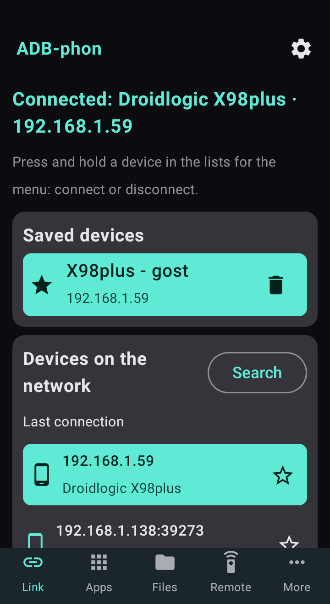

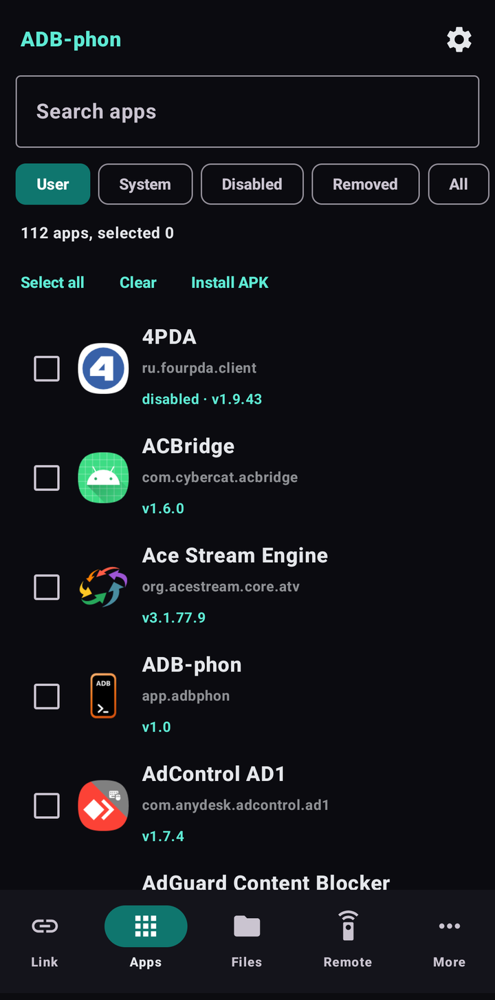

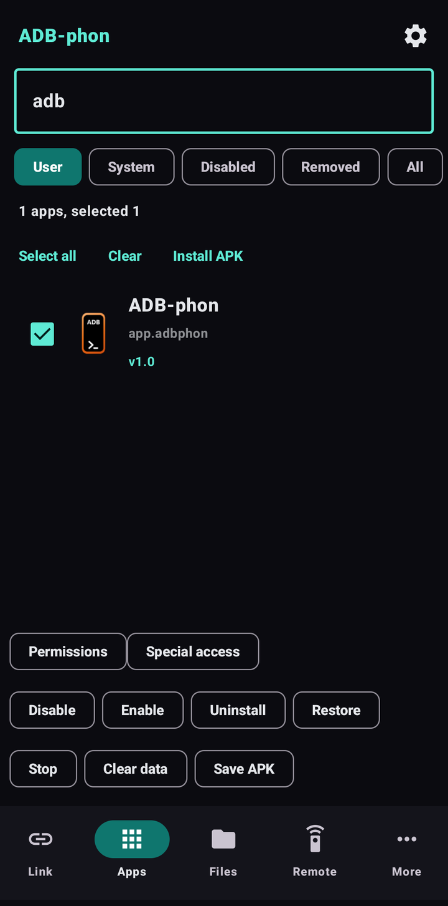

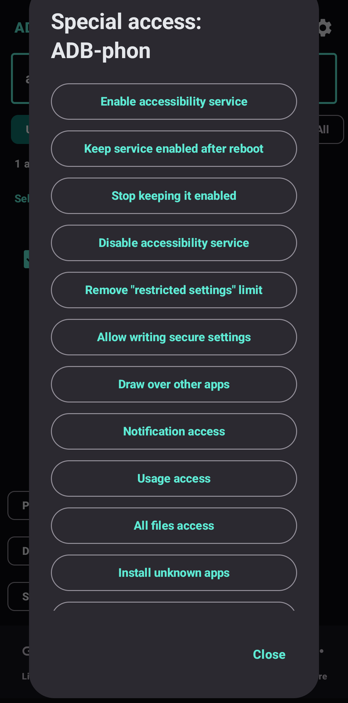

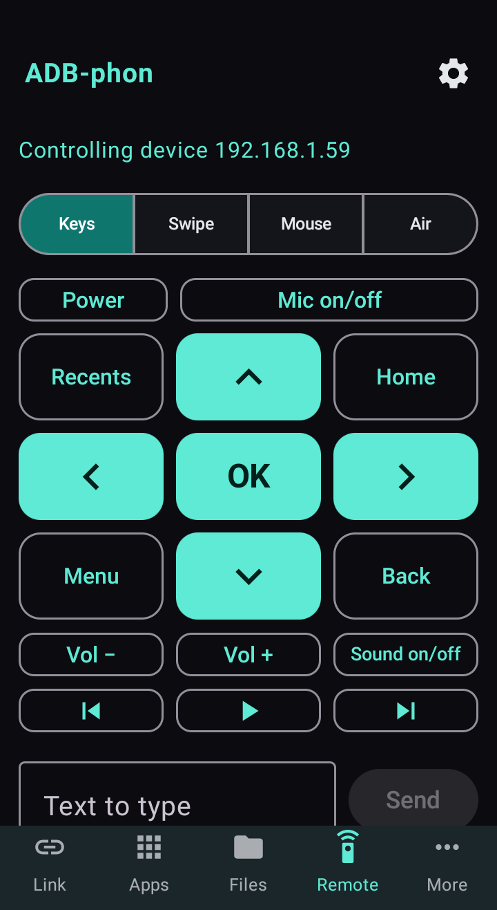

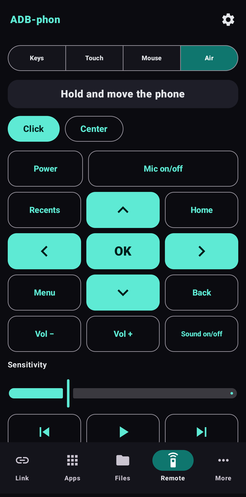

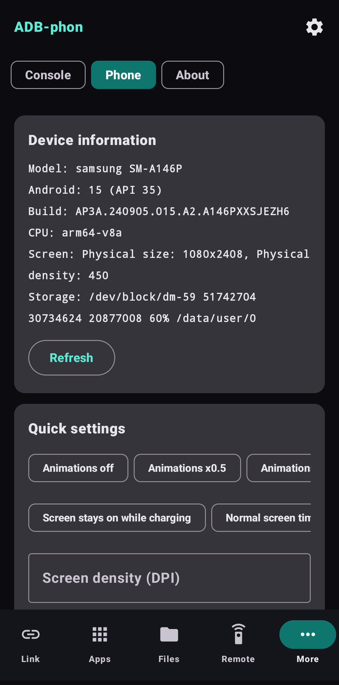

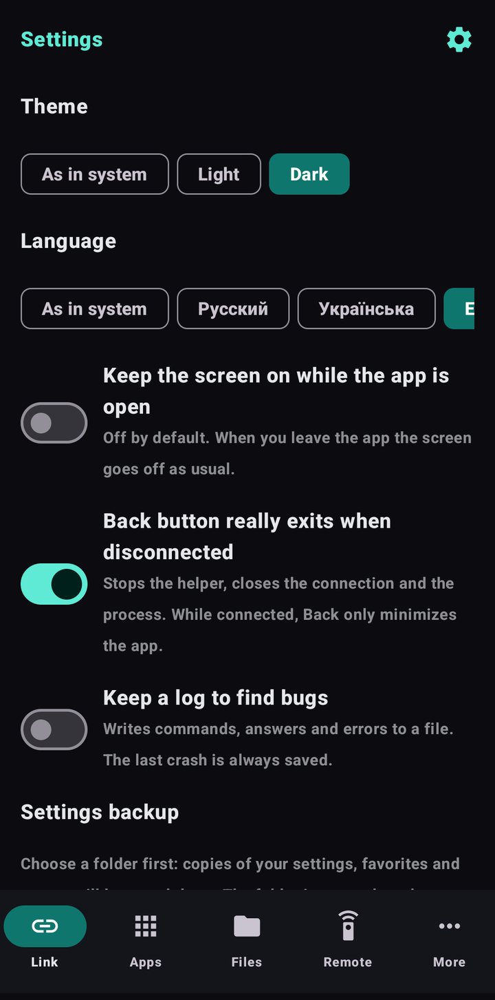

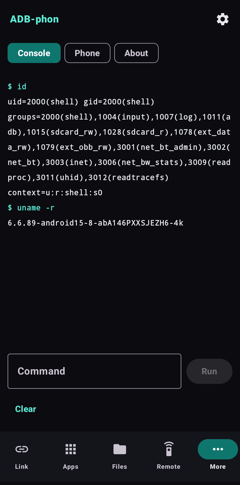

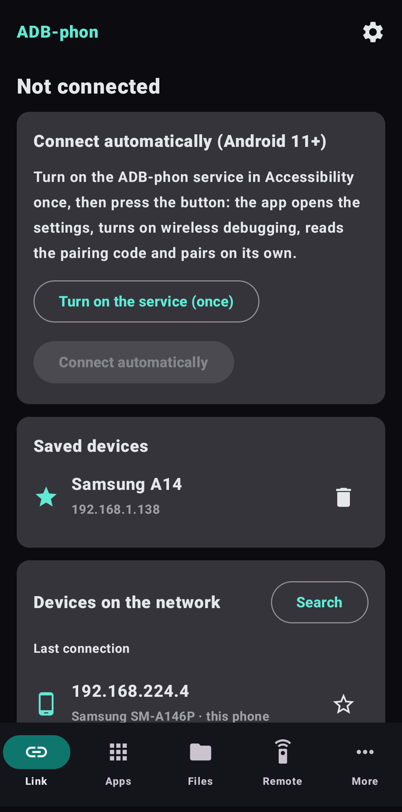

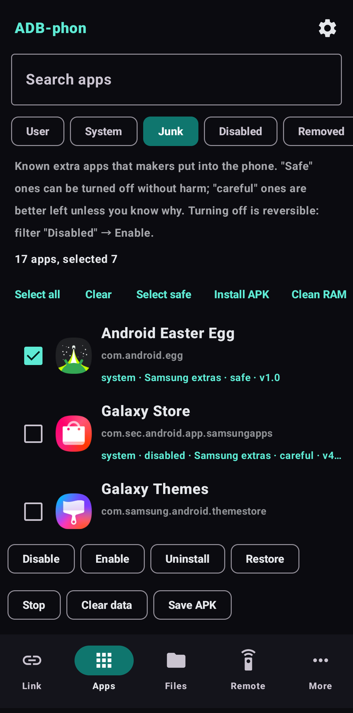

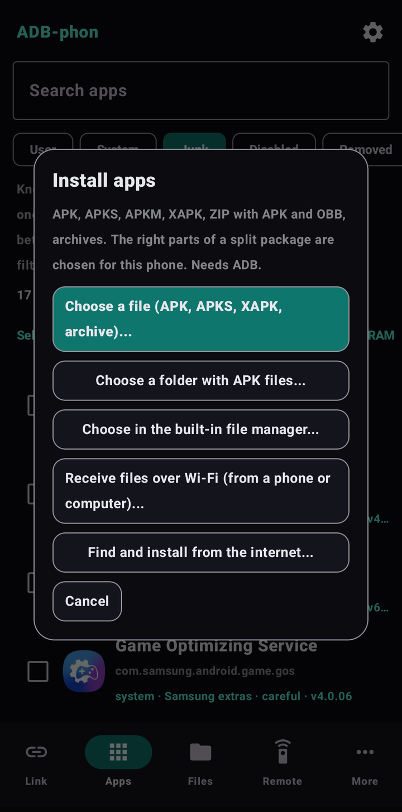

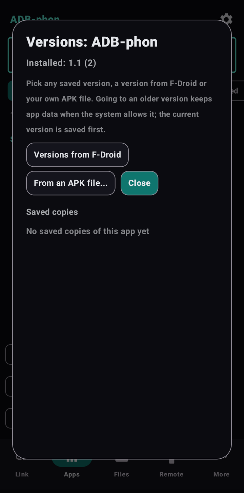

## Quick start

1. Download ADB-phon-1.2.apk and install it (allow installing from this source if Android asks).
2. Android 11 and newer: Settings, Developer options, turn on “Wireless debugging”, tap “Pair device with pairing code”. Open ADB-phon in split screen or a floating window, enter the port and the code, tap “Pair”, then “Connect”.
3. Android 8–10: once, from a computer with USB debugging, run adb tcpip 5555. In ADB-phon tap “Connect” and allow debugging on the phone.
4. For another device (TV, second phone) tap it in the “Devices in the network” list or type its IP.

## Requirements

Android 8.0 or newer (ARMv7, ARM64, x86, x86_64). Wi-Fi for wireless debugging (Android 11+). Android 8–10: one command from a computer once (adb tcpip 5555), repeated after a reboot. Tested on Android 10 (Samsung A7, S9), Android 15 (Samsung A14) and on a TV box with Android 11.

## Limitations and warnings

- Actions on system apps can break the phone: be careful, the app asks for confirmation and protects critical packages.
- ADB-phon works locally and sends nothing anywhere. The cursor helper and the remote control manage a whole device: connect only to your own devices.
- The app is not on Google Play (it would not be allowed): download the APK here. Android may warn about installing from an unknown source.
- Tested on two phones (Android 10 and 15) and one TV box (Android 11). Not yet tested on Android 8–9 and 11–14 devices of other makers; reports are welcome.
- Special access settings can differ on Xiaomi, Huawei and other firmwares; on Xiaomi also turn on “USB debugging (security settings)”.

## Built with

Kotlin and Jetpack Compose; ADB client libadb-android (MuntashirAkon, GPL-3.0 or Apache-2.0) and Conscrypt (Apache-2.0). The app is independent and not related to Google. Licensed under GPL-3.0.

## News and help

- Telegram: [t.me/PhoneInWindowSound](https://t.me/PhoneInWindowSound)

## Support the project

The app is free. If it is useful you can support its development by card, Google Pay or USDT. For USDT use only the TRON network (TRC20): coins sent over another network are lost.

- By card or Google Pay (from 50 UAH): https://secure.wayforpay.com/button/bba92579a4647
- USDT (TRON TRC20): `TXk32CLkwJryTqhmkw6urcM5CacJgPsSpJ`
