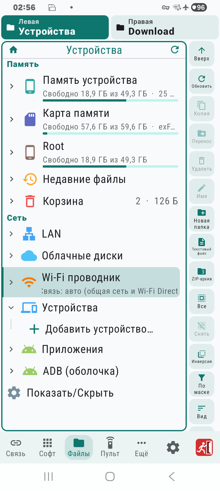
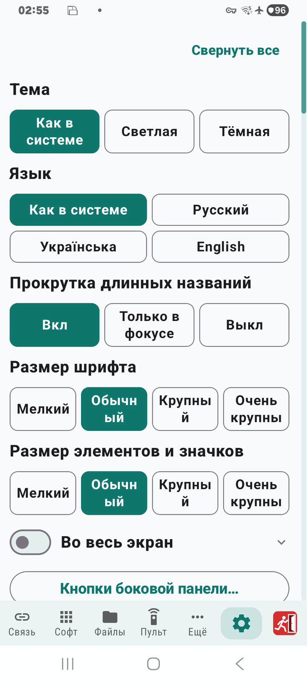
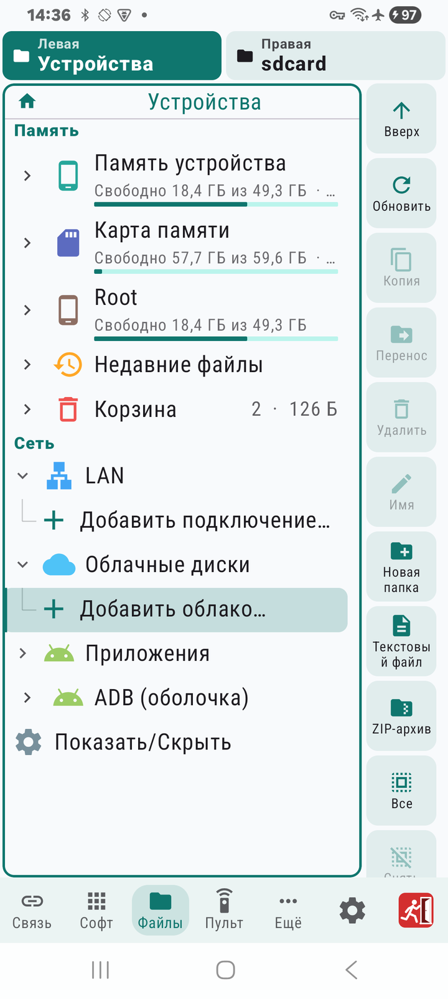
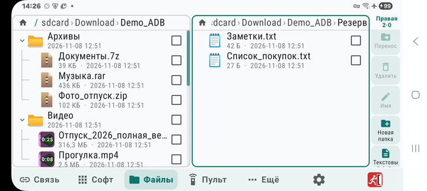
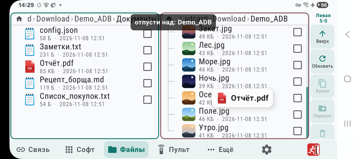
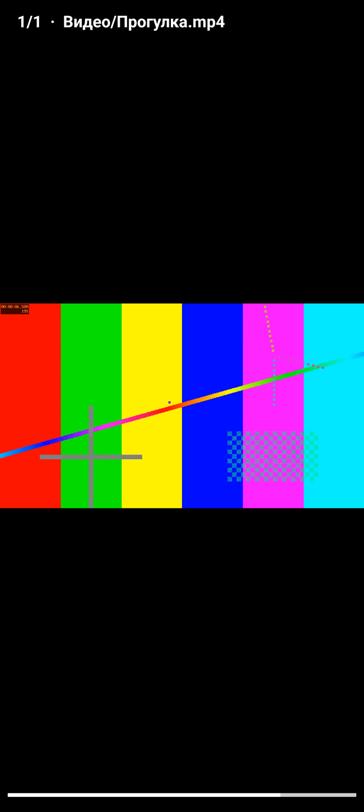
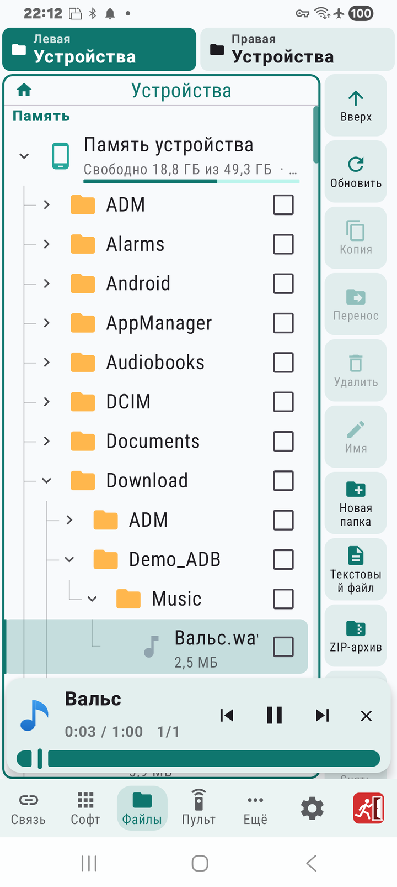
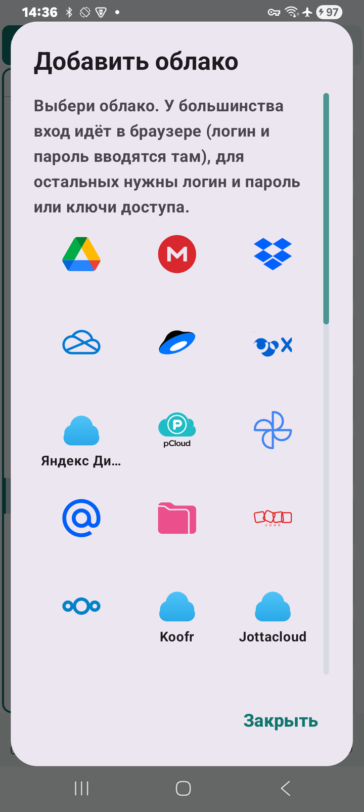
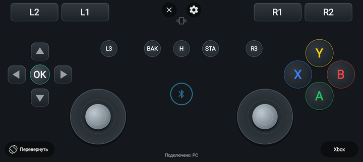

[English](README.md) · [Русский](README.ru.md) · [Українська](README.uk.md)

🌐 Все наши программы: https://drugoj00.github.io/

📖 Полная инструкция по всем функциям: [INSTRUCTION.ru.md](INSTRUCTION.ru.md)

# ADB-phon

Бесплатный ADB-менеджер прямо на телефоне: установка APK по ADB, аэромышь и пульт, особые права, которые переживают перезагрузку. Без компьютера, root не обязателен (с root не нужен даже ADB).

ADB-phon подключается к ADB этого же телефона (или другого устройства в сети) и выполняет команды с правами оболочки, как будто телефон подключён к компьютеру.

⭐ Если программа полезна, поставьте звезду этому репозиторию: это ничего не стоит и помогает другим её найти.

## Скачать

**Версия 7.5.** [ADB-phon-7.5.apk](https://github.com/drugoj00/adb-phon/releases/latest) (Assets) · [Releases](https://github.com/drugoj00/adb-phon/releases)

SHA-256: `4793bf0d9c543b0c279e06c725391269fb4f7883c7060a03fd22ff95dffd989e`

## Что нового в 7.5

- Настройки цвета: «Основной цвет» и «Цвет полосок» полосой выбора цвета с кнопкой «Как у темы». «Контраст полосок» от прежнего вида до полностью прозрачной свободной части
- Окно «Установка» после выбора ADB-phon: значок, название, пакет, вид (новая, обновление, та же версия, понижение), таблица «Сейчас / Новое» с подсветкой различий, новые и убранные разрешения
- Другая подпись: предупреждение, установка не пробуется
- Полоска установки по байтам и по файлам, итог и причины отказов
- Понижение версии: без root на Android 14 и новее с удалением данных (копия текущей версии, откат при неудаче), с root с сохранением данных; системные приложения не понижаются
- Прокрутка длинных названий: «Вкл» и «Выкл»
- Кнопки боковой панели «Файлов»: крупные иконки, перестановка долгим нажатием, на пульте удержанием «ОК» и стрелками
- «Файлы»: запоминаются положение списка и фокус

## Возможности

- **Установка APK по ADB.** Установка и обновление приложений через ADB, компьютер не нужен. Источники: файл, папка, архив (ZIP, 7z, RAR, TAR), встроенный файловый менеджер (в том числе флешки через ADB), сетевые папки (SMB), приём файлов по Wi‑Fi из браузера, поиск в интернете (F-Droid, GitHub, ссылка). Пакеты из нескольких частей APKS, APKM, XAPK и ZIP с APK и OBB: нужные части для вашего телефона выбираются сами. Пакетная установка.
- **Аэромышь и мышь.** Гироскоп телефона работает как указка. На экране управляемого устройства появляется настоящий курсор (помощник создаёт виртуальную мышь). Кнопка «Воздух» работает в двух режимах, которые выбираются круглым переключателем: коснуться, чтобы включить, и ещё раз, чтобы выключить, либо держать, пока водишь телефоном. Клик, прокрутка, ОК, Назад, Домой, Меню, стрелки, громкость, звук и микрофон вкл/выкл. Касание тоже мгновенное: помощник отправляет настоящие касания, поэтому тапы и свайпы работают даже на слабых ТВ-приставках.
- **Особые права, переживают перезагрузку.** Включение службы спецвозможностей, удержание её после перезагрузки (на Android 13–14 она часто выключается сама), снятие «ограниченных настроек», запись защищённых настроек, поверх других окон, уведомления, статистика, все файлы, установка из неизвестных источников, без ограничений батареи.
- **Пульт.** Четыре режима переключателем: Кнопки, Свайп, Мышь, Воздух. Домой, назад, меню, крестовина и ОК, громкость, медиа-кнопки, питание, недавние, ввод текста. Свайпы = стрелки, касание = ОК, кнопки прокрутки. Кнопки срабатывают мгновенно. Для телефонов, телевизоров и приставок.
- **SSH.** Подключение к компьютеру или серверу по SSH (Linux, macOS, Windows с SSH-сервером): терминал и файлы по SFTP (просмотр, скачать, загрузить, удалить). Вход по паролю или файлу ключа; ключ сервера запоминается при первом подключении.
- **Мышь ПК.** Телефон работает как Bluetooth-мышь и клавиатура для компьютера, ноутбука, планшета, iPhone или телевизора (Android 9+): тачпад, клики, прокрутка, Enter, Esc, стрелки, Win, Ctrl+C/V, ввод текста. На компьютер ничего ставить не нужно.
- **Простое подключение.** Автопоиск устройств в сети с именами, избранные с вашими названиями, ручной ввод IP. Android 11+: автоматическое сопряжение без ввода кода (служба спецвозможностей сама читает код в системном окне) или сопряжение по коду. Android 8–10: один раз команда с компьютера, дальше программа подключается сама. Управление другим устройством по IP; долгое нажатие на устройство отключает его.
- **Приложения.** Значки, поиск, фильтры (мои, системные, мусор, отключённые, удалённые), отключить и включить, удалить и восстановить, остановить, очистить данные, сохранить APK, разрешения переключателями, пакетные действия (в том числе пакетное удаление), защита критичных пакетов, кнопка «Очистить ОЗУ».
- **Чистильщик лишнего.** Фильтр «Мусор» показывает известные ненужные системные приложения (Samsung, Google, Microsoft, службы Facebook, партнёрские) с метками «безопасно» и «осторожно». «Выбрать безопасные» и отключить; это обратимо («Отключённые» → «Включить»).
- **Копии и версии.** Перед удалением приложения его APK сохраняется. Кнопка «Версии» ставит любую версию, в том числе старую, из сохранённых копий, из F-Droid или из своего файла.
- **Копия с данными.** Копия любого приложения вместе с его данными и восстановление. С root сохраняются все данные, по ADB только то, что разрешает система (внешние данные и, если приложение разрешает, внутренние на Android 10 и старше). Системное окно подтверждения программа нажимает сама.
- **Защита главного экрана.** Единственный главный экран нельзя отключить или удалить по ошибке: если запасного нет, программа предлагает скачать «Меню приложений» с GitHub и ставит его одним нажатием (нужен интернет).
- **Обновления.** Проверяет GitHub на новую версию по кнопке и предлагает обновиться одним нажатием; в настройках можно включить автоматическую проверку раз в сутки (по умолчанию выключена).
- **Файлы.** Двухпанельный файловый менеджер: память телефона, карта памяти, USB-накопители, архивы (ZIP, 7z, RAR, TAR), Android/data по ADB, сетевые папки и облачные диски в одном дереве. Создать, переименовать, копировать, переместить, удалить, ZIP, текстовые файлы, встроенный редактор, выбор по маске, перетаскивание между панелями, корзина для телефона, карты, облаков и сетевых папок, окно «Файл уже существует» («Переименовать», «Заменить», «Отменить», «Применить ко всем»). После перезапуска возвращаются папки и места.
- **Облачные диски.** Google Диск, MEGA, Dropbox, OneDrive, Яндекс Диск, Box, pCloud и десятки других сервисов. Облака работают через отдельный бесплатный модуль «ADB-phon Облака»: его предлагается скачать один раз, когда добавляется облако; скачанный файл после установки удаляется сам. Вход в браузере; если общий ключ программы занят, мастер «Свой ключ» по шагам поможет создать собственный.
- **Сетевые папки.** SMB, SFTP, FTP, FTPS и WebDAV: просмотр, копирование и перенос в обе стороны, в том числе напрямую между двумя сетевыми источниками и из облака в сеть. Файл пишется безопасно: оригинал не пропадает при сбое или отмене.
- **Геймпад.** Телефон как геймпад для ПК по Bluetooth (вибрация с ПК) и экранный геймпад «Играть на этом телефоне» (прототип): стики, A/B/X/Y, курки, Back, Guide и Start поверх любой игры; раскладку, мёртвую зону, размер и прозрачность можно менять.
- **Телефон.** Сведения об устройстве, мониторинг, снимок и запись экрана, очистка кэша всех приложений, быстрые настройки (тёмная тема, Wi-Fi, данные, Bluetooth, автоповорот, шрифт, гашение экрана, показ касаний, анимации, DPI), перезагрузка (обычная, recovery, загрузчик).
- **Устройства и Видеоокно.** В дереве «Файлов» одна группа «Устройства»: компьютеры и Android-устройства вместе, у каждого папки «Файлы» и «Видеоокно». «Видеоокно» показывает экран компьютера или другого Android и управляет им: автоповорот, ввод текста на любом языке.
- **Видеозвонок.** Видеозвонок между Android-устройствами и компьютерами (Windows-программа «Телефон в окне со звуком» 3.0). Как позвонить: откройте «Связь → Видеозвонки», нажмите «Добавить человека…», впишите имя и код его программы (XXXX-XXXX-XXXX; код есть в программе собеседника: на Windows в «Связи по интернету», на Android в этом же разделе), затем «Позвонить». У собеседника появится окно «Звонит…»; камера и микрофон включаются, только когда он нажмёт «Ответить». В звонке кнопки «Звук», «Динамик», «Камера», «Завершить». Приём звонков включён по умолчанию (значок в шторке), выключатель в том же разделе.
- **Приглашения.** Подключение к сети Tailscale по приглашению с ПК. Другой VPN отключается на время сеанса связи и возвращается как был.
- **Совместимость с Shizuku.** Приложения с поддержкой Shizuku получают права shell через ADB-phon.
- **Консоль.** Живой терминал: любые команды оболочки, история, Ctrl+C, Tab, «Мои команды».
- **Настройки.** Тема (авто, светлая, тёмная), динамические цвета из обоев и основной цвет, размер шрифта и элементов, режим «Во весь экран», настройки цвета (основной цвет, цвет полосок, контраст полосок), свои значки папок, файлов, дисков, приложений и кнопок боковой панели, язык (русский, украинский, английский), держать экран включённым, журнал для поиска ошибок, резервная копия и восстановление настроек в выбранную папку, установка любой версии программы с GitHub.
- **Бесплатно.** Без рекламы, исходный код открыт.

## Скриншоты

## Видео

- [Геймпад: Android ↔ Android (Asphalt 9)](https://youtu.be/V30zZv2MmFM)
- [Геймпад: Android ↔ ПК (GTA 5)](https://youtu.be/OmIT5jgrWFw)

## Быстрый старт

1. Скачайте ADB-phon-7.0.apk и установите его (если Android спросит, разрешите установку из этого источника).
2. Android 11 и новее: «Настройки» → «Для разработчиков» → включите «Беспроводная отладка» → «Подключение устройства с помощью кода». Откройте ADB-phon в разделённом экране или плавающем окне, введите порт и код, нажмите «Сопряжение», затем «Подключиться».
3. Android 8–10: один раз с компьютера по USB выполните adb tcpip 5555. В ADB-phon нажмите «Подключиться» и разрешите отладку на телефоне.
4. Для другого устройства (телевизор, второй телефон) нажмите его в списке «Устройства в сети» или введите IP.

## Требования

Android 8.0 и новее (ARMv7, ARM64, x86, x86_64). Для беспроводной отладки (Android 11+) нужен Wi-Fi. Android 8–10: один раз команда с компьютера (adb tcpip 5555), после перезагрузки повторить. Проверено на Android 10 (Samsung A7, S9), Android 15 (Samsung A14) и на ТВ-приставках с Android 9, 11 и 12. Root в «Файлах»: с root (su) открывается всё и меняются права доступа; через ADB без root доступны /system, Android/data и /data/local/tmp, а /data и права чужих файлов закрыты самим Android.

## Ограничения и предупреждения

- Действия над системными приложениями могут сломать телефон: будьте осторожны, программа просит подтверждение и защищает критичные пакеты.
- ADB-phon работает локально и никуда ничего не отправляет. Помощник с курсором и пульт управляют устройством целиком: подключайтесь только к своим устройствам.
- В Google Play программы нет (такое там не разрешено): скачивайте APK здесь. Android может предупредить об установке из неизвестного источника.
- Проверено на трёх телефонах (Android 10 и 15) и ТВ-приставках (Android 9, 11, 12). На Android 8 и на устройствах x86 пока не проверялось, отзывы приветствуются.
- Для облачных дисков нужен отдельный модуль «ADB-phon Облака» (скачивается один раз, нужен интернет). Google Диск: общий ключ программы пробный (первые 100 пользователей), дальше создайте свой ключ в программе. Архивы RAR5 поддерживаются (в том числе с паролем). FTPS: просмотр и скачивание проверены, загрузка только частично.
- SSH и «Мышь ПК» новые и проверены частично: SSH проверен на совместимость с OpenSSH для Windows до этапа пароля; Bluetooth-мышь есть не на всех телефонах (часть прошивок выключает профиль HID).
- Особые права на Xiaomi, Huawei и других прошивках могут отличаться; на Xiaomi включите ещё «Отладка по USB (настройки безопасности)».
- Видеоокно по адресу Tailscale (100.x) работает, если оба устройства в сети Tailscale (при постоянном другом VPN на телефоне нужен адрес той же сети). Ввод текста в Видеоокне любой раскладкой требует ADB-phon 7.0 или новее на целевом устройстве.

## На чём сделана

Kotlin и Jetpack Compose; ADB-клиент libadb-android (MuntashirAkon, GPL-3.0 или Apache-2.0) и Conscrypt (Apache-2.0). Программа независимая и не связана с Google. Лицензия GPL-3.0.

## Новости и помощь

- Telegram: [t.me/PhoneInWindowSound](https://t.me/PhoneInWindowSound)

## Поддержать проект

Программа бесплатная. Если она вам полезна, можно поддержать разработку банковской картой, Google Pay или USDT. Для USDT только сеть TRON (TRC20): монеты, отправленные по другой сети, теряются.

- Картой или Google Pay (от 50 грн): https://secure.wayforpay.com/button/bba92579a4647
- USDT (TRON TRC20): `TXk32CLkwJryTqhmkw6urcM5CacJgPsSpJ`
