[English](README.md) · [Русский](README.ru.md) · [Українська](README.uk.md)

🌐 Все наши программы: https://drugoj00.github.io/

# ADB-phon

Бесплатный ADB-менеджер прямо на телефоне: установка APK по ADB, аэромышь и пульт, особые права, которые переживают перезагрузку. Без компьютера, root не обязателен (с root не нужен даже ADB).

ADB-phon подключается к ADB этого же телефона (или другого устройства в сети) и выполняет команды с правами оболочки, как будто телефон подключён к компьютеру.

⭐ Если программа полезна, поставьте звезду этому репозиторию: это ничего не стоит и помогает другим её найти.

## Скачать

**Версия 2.0.** [ADB-phon-2.0.apk](https://github.com/drugoj00/adb-phon/releases/latest) (Assets) · [Releases](https://github.com/drugoj00/adb-phon/releases)

SHA-256: `2574c2df92d812387d407363d5b2e3231f7e46497f28fd4bfd1a15261597e196`

## Что нового в 2.0

- SSH: терминал и файлы (SFTP) компьютера или сервера.
- Мышь ПК: телефон как Bluetooth-мышь и клавиатура.
- Пульт: вкладка «Свайп» (свайпы = стрелки, прокрутка); кнопки мгновенные.
- Автоподключение к последнему устройству при запуске; подключённое выделено.
- Долгий тап по устройству: подключить или отключить; «Подключено: название · адрес».
- Кнопка «Перезапустить лончер» против залипших стрелок на ТВ-приставках.
- Новая адаптивная иконка; удаление сохранённых прошлых версий; компактный интерфейс.
- Исправлено: вкладки управления без реального подключения; чужое устройство принималось за этот телефон; кнопки пульта срабатывали с задержкой ~1 с.

## Возможности

- **Установка APK по ADB.** Установка и обновление приложений через ADB, компьютер не нужен. Источники: файл, папка, архив (ZIP, 7z, RAR, TAR), встроенный файловый менеджер (в том числе флешки через ADB), сетевые папки (SMB), приём файлов по Wi‑Fi из браузера, поиск в интернете (F-Droid, GitHub, ссылка). Пакеты из нескольких частей APKS, APKM, XAPK и ZIP с APK и OBB: нужные части для вашего телефона выбираются сами. Пакетная установка.
- **Аэромышь и мышь.** Гироскоп телефона работает как указка. На экране управляемого устройства появляется настоящий курсор (помощник создаёт виртуальную мышь). Кнопка «Воздух» работает в двух режимах, которые выбираются круглым переключателем: коснуться, чтобы включить, и ещё раз, чтобы выключить, либо держать, пока водишь телефоном. Клик, прокрутка, ОК, Назад, Домой, Меню, стрелки, громкость, звук и микрофон вкл/выкл. Касание тоже мгновенное: помощник отправляет настоящие касания, поэтому тапы и свайпы работают даже на слабых ТВ-приставках.
- **Особые права, переживают перезагрузку.** Включение службы спецвозможностей, удержание её после перезагрузки (на Android 13–14 она часто выключается сама), снятие «ограниченных настроек», запись защищённых настроек, поверх других окон, уведомления, статистика, все файлы, установка из неизвестных источников, без ограничений батареи.
- **Пульт.** Четыре режима переключателем: Кнопки, Свайп, Мышь, Воздух. Домой, назад, меню, крестовина и ОК, громкость, медиа-кнопки, питание, недавние, ввод текста. Свайпы = стрелки, касание = ОК, кнопки прокрутки. Кнопки срабатывают мгновенно. Для телефонов, телевизоров и приставок.
- **SSH.** Подключение к компьютеру или серверу по SSH (Linux, macOS, Windows с SSH-сервером): терминал и файлы по SFTP (просмотр, скачать, загрузить, удалить). Вход по паролю; ключ сервера запоминается при первом подключении.
- **Мышь ПК.** Телефон работает как Bluetooth-мышь и клавиатура для компьютера, ноутбука, планшета, iPhone или телевизора (Android 9+): тачпад, клики, прокрутка, Enter, Esc, стрелки, Win, Ctrl+C/V, ввод текста. На компьютер ничего ставить не нужно.
- **Простое подключение.** Автопоиск устройств в сети с именами, избранные с вашими названиями, ручной ввод IP. Android 11+: автоматическое сопряжение без ввода кода (служба спецвозможностей сама читает код в системном окне) или сопряжение по коду. Android 8–10: один раз команда с компьютера, дальше программа подключается сама. Управление другим устройством по IP; долгое нажатие на устройство — отключиться.
- **Приложения.** Значки, поиск, фильтры (мои, системные, мусор, отключённые, удалённые), отключить и включить, удалить и восстановить, остановить, очистить данные, сохранить APK, разрешения переключателями, пакетные действия (в том числе пакетное удаление), защита критичных пакетов, кнопка «Очистить ОЗУ».
- **Чистильщик лишнего.** Фильтр «Мусор» показывает известные ненужные системные приложения (Samsung, Google, Microsoft, службы Facebook, партнёрские) с метками «безопасно» и «осторожно». «Выбрать безопасные» и отключить; это обратимо («Отключённые» → «Включить»).
- **Копии и версии.** Перед удалением приложения его APK сохраняется. Кнопка «Версии» ставит любую версию, в том числе старую, из сохранённых копий, из F-Droid или из своего файла.
- **Файлы.** Обзор папок, в том числе Android/data, создать, переименовать, копировать, переместить, удалить.
- **Телефон.** Сведения об устройстве, мониторинг, снимок и запись экрана, очистка кэша всех приложений, быстрые настройки (тёмная тема, Wi-Fi, данные, Bluetooth, автоповорот, шрифт, гашение экрана, показ касаний, анимации, DPI), перезагрузка (обычная, recovery, загрузчик).
- **Консоль.** Любые команды оболочки.
- **Настройки.** Тема (авто, светлая, тёмная), язык (русский, украинский, английский), держать экран включённым, журнал для поиска ошибок, резервная копия и восстановление настроек в выбранную папку, установка любой версии программы с GitHub.
- **Бесплатно.** Без рекламы, исходный код открыт.

## Скриншоты

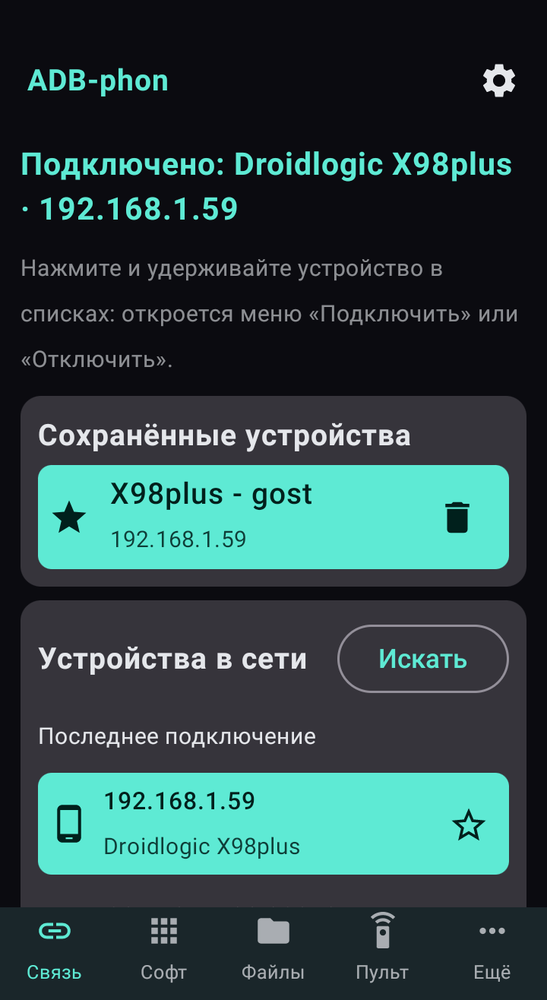

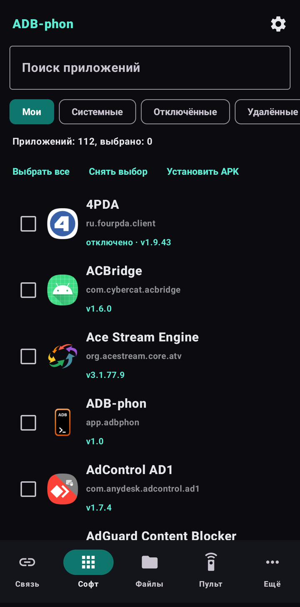

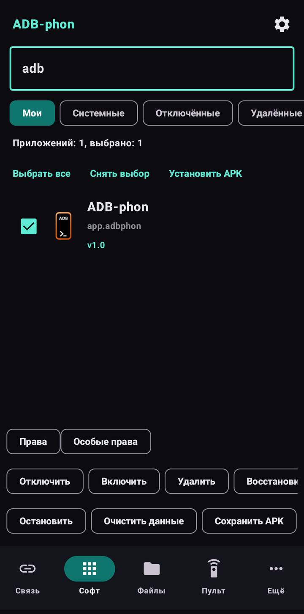

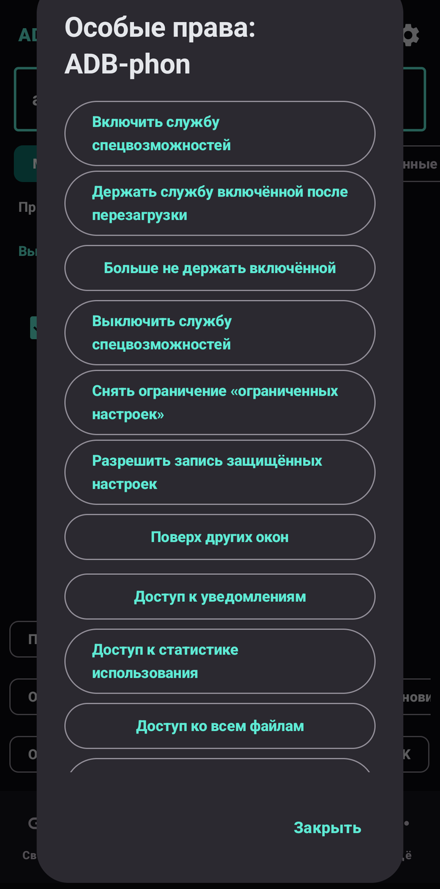

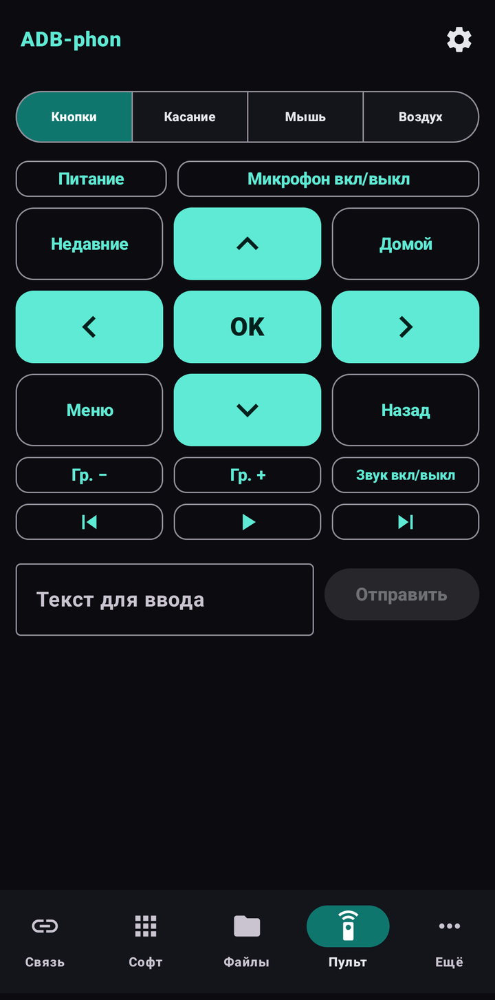

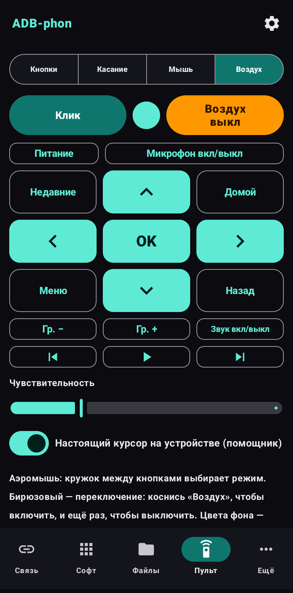

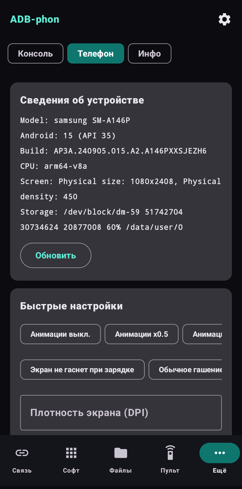

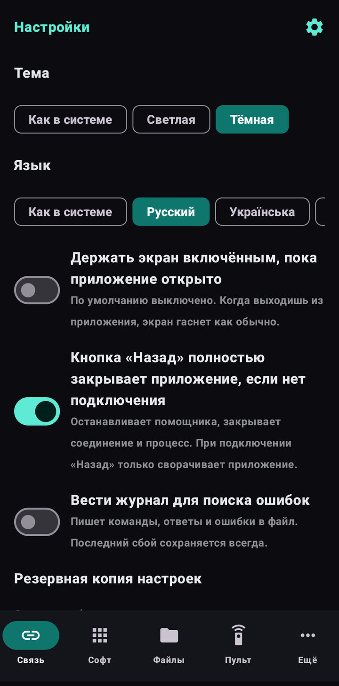

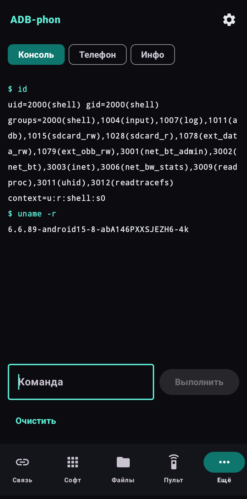

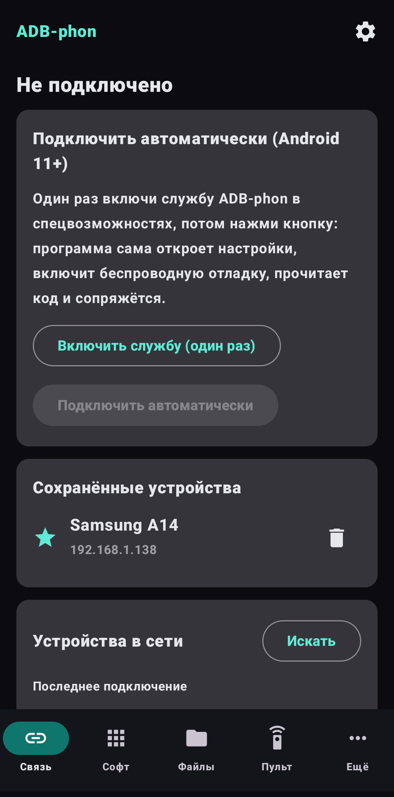

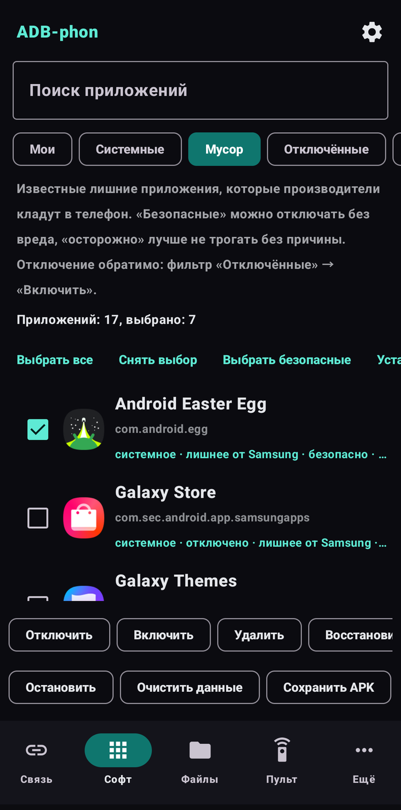

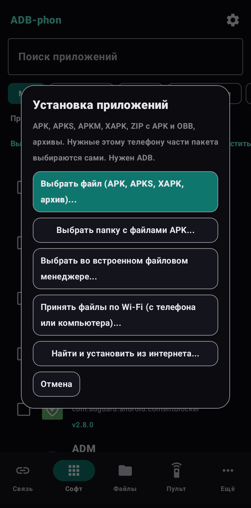

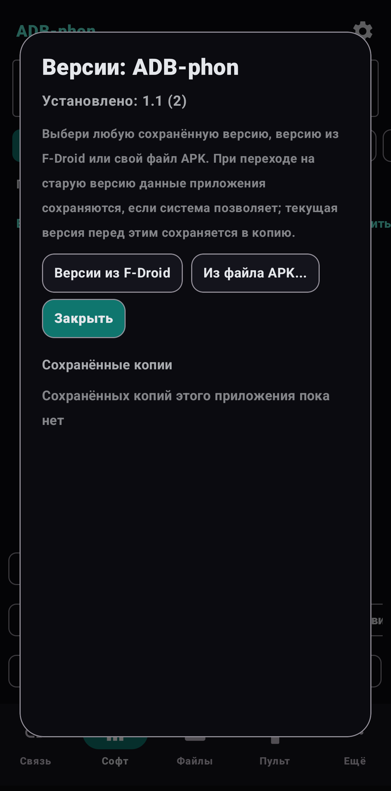

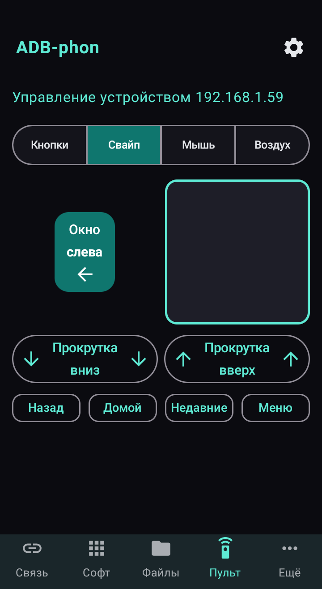

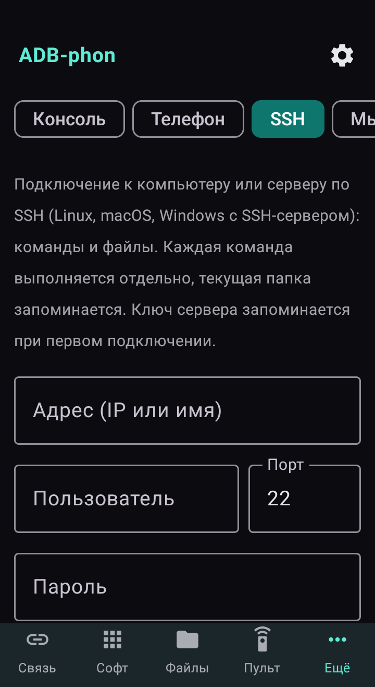

## Быстрый старт

1. Скачайте ADB-phon-2.0.apk и установите его (если Android спросит, разрешите установку из этого источника).
2. Android 11 и новее: «Настройки» → «Для разработчиков» → включите «Беспроводная отладка» → «Подключение устройства с помощью кода». Откройте ADB-phon в разделённом экране или плавающем окне, введите порт и код, нажмите «Сопряжение», затем «Подключиться».
3. Android 8–10: один раз с компьютера по USB выполните adb tcpip 5555. В ADB-phon нажмите «Подключиться» и разрешите отладку на телефоне.
4. Для другого устройства (телевизор, второй телефон) нажмите его в списке «Устройства в сети» или введите IP.

## Требования

Android 8.0 и новее (ARMv7, ARM64, x86, x86_64). Для беспроводной отладки (Android 11+) нужен Wi-Fi. Android 8–10: один раз команда с компьютера (adb tcpip 5555), после перезагрузки повторить. Проверено на Android 10 (Samsung A7, S9), Android 15 (Samsung A14) и на ТВ-приставке с Android 11.

## Ограничения и предупреждения

- Действия над системными приложениями могут сломать телефон: будьте осторожны, программа просит подтверждение и защищает критичные пакеты.
- ADB-phon работает локально и никуда ничего не отправляет. Помощник с курсором и пульт управляют устройством целиком: подключайтесь только к своим устройствам.
- В Google Play программы нет (такое там не разрешено): скачивайте APK здесь. Android может предупредить об установке из неизвестного источника.
- Проверено на двух телефонах (Android 10 и 15) и одной ТВ-приставке (Android 11). На Android 8–9 и 11–14 других производителей пока не проверялось, отзывы приветствуются.
- SSH и «Мышь ПК» новые и проверены частично: SSH — на совместимость с OpenSSH для Windows до этапа пароля; Bluetooth-мышь есть не на всех телефонах (часть прошивок выключает профиль HID).
- Особые права на Xiaomi, Huawei и других прошивках могут отличаться; на Xiaomi включите ещё «Отладка по USB (настройки безопасности)».

## На чём сделана

Kotlin и Jetpack Compose; ADB-клиент libadb-android (MuntashirAkon, GPL-3.0 или Apache-2.0) и Conscrypt (Apache-2.0). Программа независимая и не связана с Google. Лицензия GPL-3.0.

## Новости и помощь

- Telegram: [t.me/PhoneInWindowSound](https://t.me/PhoneInWindowSound)

## Поддержать проект

Программа бесплатная. Если она вам полезна, можно поддержать разработку банковской картой, Google Pay или USDT. Для USDT только сеть TRON (TRC20): монеты, отправленные по другой сети, теряются.

- Картой или Google Pay (от 50 грн): https://secure.wayforpay.com/button/bba92579a4647
- USDT (TRON TRC20): `TXk32CLkwJryTqhmkw6urcM5CacJgPsSpJ`
