[English](README.md) · [Русский](README.ru.md) · [Українська](README.uk.md)

🌐 Усі наші програми: https://drugoj00.github.io/

# ADB-phon

Безкоштовний ADB-менеджер прямо на телефоні: встановлення APK через ADB, аеромиша й пульт, особливі права, що переживають перезавантаження. Без комп’ютера, root не обов’язковий (з root не потрібен навіть ADB).

ADB-phon підключається до ADB цього ж телефона (або іншого пристрою в мережі) і виконує команди з правами оболонки, наче телефон підключено до комп’ютера.

⭐ Якщо програма корисна, поставте зірку цьому репозиторію: це нічого не коштує й допомагає іншим її знайти.

## Завантажити

**Версія 2.0.** [ADB-phon-2.0.apk](https://github.com/drugoj00/adb-phon/releases/latest) (Assets) · [Releases](https://github.com/drugoj00/adb-phon/releases)

SHA-256: `71ffed4f9fc5e0efbf963b4b73fe5742ae5314f728904d130f1c4036c0238d03`

## Що нового в 2.0

- SSH: термінал і файли (SFTP) комп’ютера або сервера.
- Миша ПК: телефон як Bluetooth-миша й клавіатура.
- Пульт: вкладка «Свайп» (свайпи = стрілки, прокручування); кнопки миттєві.
- Автопідключення до останнього пристрою під час запуску; підключений виділено.
- Довгий дотик на пристрої: підключити або відключити; «Підключено: назва · адреса».
- Кнопка «Перезапустити лончер» проти залиплих стрілок на ТВ-приставках.
- Нова адаптивна іконка; видалення збережених попередніх версій; компактний інтерфейс.
- Виправлено: вкладки керування без справжнього підключення; чужий пристрій сприймався за цей телефон; кнопки пульта спрацьовували із затримкою ~1 с.

## Можливості

- **Встановлення APK через ADB.** Встановлення й оновлення застосунків через ADB, комп’ютер не потрібен. Джерела: файл, тека, архів (ZIP, 7z, RAR, TAR), вбудований файловий менеджер (зокрема флешки через ADB), мережеві теки (SMB), приймання файлів по Wi‑Fi з браузера, пошук в інтернеті (F-Droid, GitHub, посилання). Пакети з кількох частин APKS, APKM, XAPK і ZIP з APK та OBB: потрібні частини для вашого телефона обираються самі. Пакетне встановлення.
- **Аеромиша та миша.** Гіроскоп телефона працює як указка. На екрані керованого пристрою з’являється справжній курсор (помічник створює віртуальну мишу). Кнопка «Повітря» працює у двох режимах, які обираються круглим перемикачем: торкнутися, щоб увімкнути, і ще раз, щоб вимкнути, або тримати, поки водиш телефоном. Клік, прокручування, ОК, Назад, Додому, Меню, стрілки, гучність, звук і мікрофон увімк/вимк. Дотик теж миттєвий: помічник надсилає справжні дотики, тому тапи й свайпи працюють навіть на слабких ТВ-приставках.
- **Особливі права, переживають перезавантаження.** Увімкнення служби спецможливостей, утримання її після перезавантаження (на Android 13–14 вона часто вимикається сама), зняття «обмежених налаштувань», запис захищених налаштувань, поверх інших вікон, сповіщення, статистика, усі файли, встановлення з невідомих джерел, без обмежень батареї.
- **Пульт.** Чотири режими перемикачем: Кнопки, Свайп, Миша, Повітря. Додому, назад, меню, хрестовина й ОК, гучність, медіа-кнопки, живлення, останні, введення тексту. Свайпи = стрілки, дотик = ОК, кнопки прокручування. Кнопки спрацьовують миттєво. Для телефонів, телевізорів і приставок.
- **SSH.** Підключення до комп’ютера або сервера по SSH (Linux, macOS, Windows із SSH-сервером): термінал і файли по SFTP (перегляд, завантажити, вивантажити, видалити). Вхід за паролем; ключ сервера запам’ятовується під час першого підключення.
- **Миша ПК.** Телефон працює як Bluetooth-миша й клавіатура для комп’ютера, ноутбука, планшета, iPhone або телевізора (Android 9+): тачпад, кліки, прокручування, Enter, Esc, стрілки, Win, Ctrl+C/V, введення тексту. На комп’ютер нічого ставити не потрібно.
- **Просте підключення.** Автопошук пристроїв у мережі з іменами, обрані з вашими назвами, ручне введення IP. Android 11+: автоматичне сполучення без введення коду (служба спецможливостей сама читає код у системному вікні) або сполучення за кодом. Android 8–10: один раз команда з комп’ютера, далі програма підключається сама. Керування іншим пристроєм за IP; довге натискання на пристрій — відключитися.
- **Застосунки.** Значки, пошук, фільтри (мої, системні, сміття, вимкнені, видалені), вимкнути й увімкнути, видалити й відновити, зупинити, очистити дані, зберегти APK, дозволи перемикачами, пакетні дії (зокрема пакетне видалення), захист критичних пакетів, кнопка «Очистити ОЗП».
- **Чистильник зайвого.** Фільтр «Сміття» показує відомі непотрібні системні застосунки (Samsung, Google, Microsoft, служби Facebook, партнерські) з позначками «безпечно» та «обережно». «Обрати безпечні» і вимкнути; це оборотно («Вимкнені» → «Увімкнути»).
- **Копії та версії.** Перед видаленням застосунку його APK зберігається. Кнопка «Версії» встановлює будь-яку версію, зокрема стару, зі збережених копій, з F-Droid або зі свого файлу.
- **Файли.** Огляд тек, зокрема Android/data, створити, перейменувати, копіювати, перемістити, видалити.
- **Телефон.** Відомості про пристрій, моніторинг, знімок і запис екрана, очищення кешу всіх застосунків, швидкі налаштування (темна тема, Wi-Fi, дані, Bluetooth, автоповорот, шрифт, згасання екрана, показ дотиків, анімації, DPI), перезавантаження (звичайне, recovery, завантажувач).
- **Консоль.** Будь-які команди оболонки.
- **Налаштування.** Тема (авто, світла, темна), мова (українська, російська, англійська), тримати екран увімкненим, журнал для пошуку помилок, резервна копія й відновлення налаштувань у вибрану теку, встановлення будь-якої версії програми з GitHub.
- **Безкоштовно.** Без реклами, відкритий код.

## Скриншоти

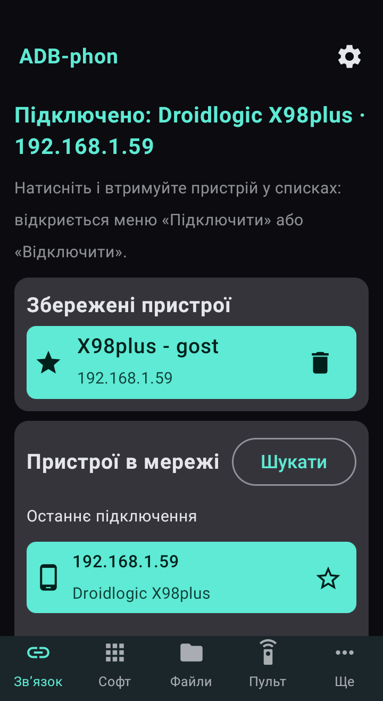

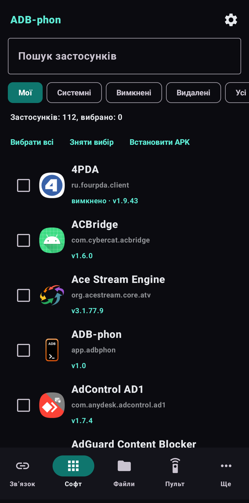

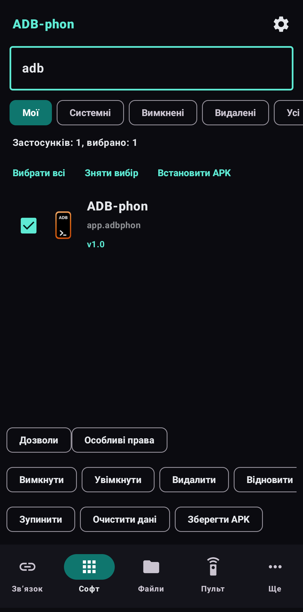

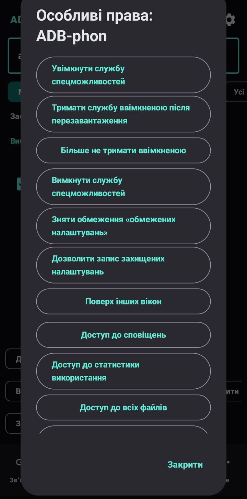

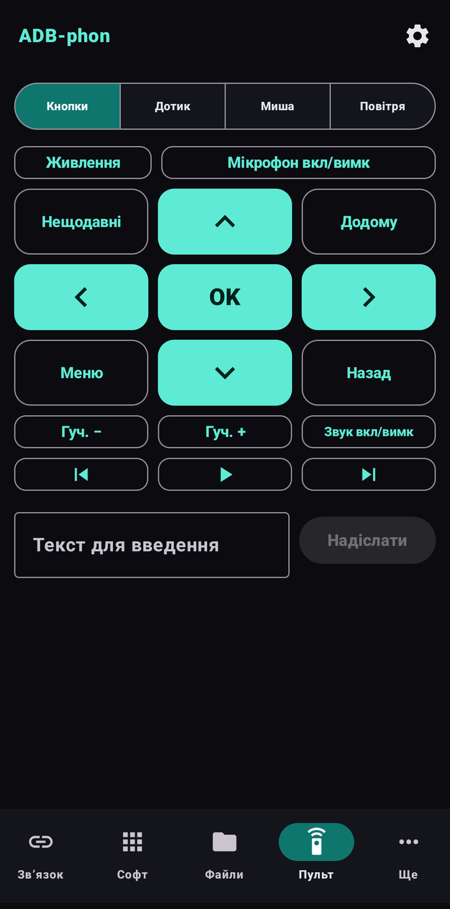

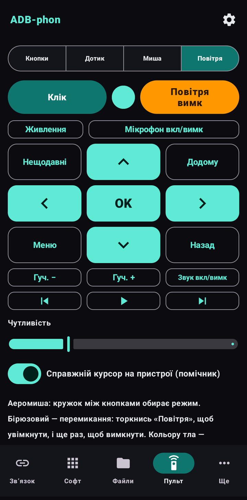

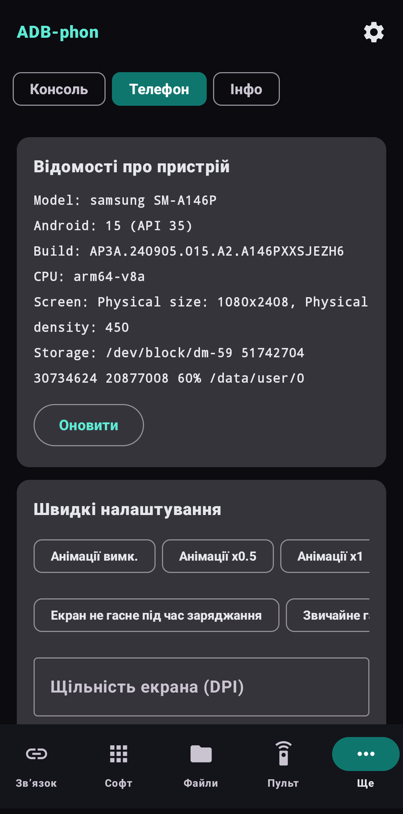

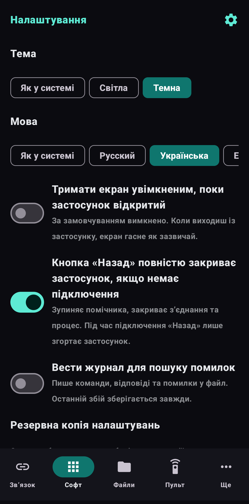

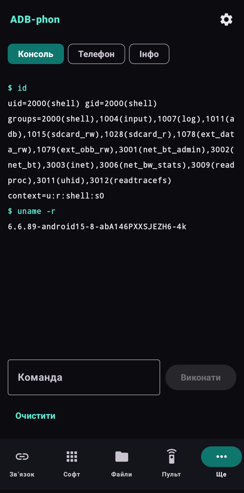

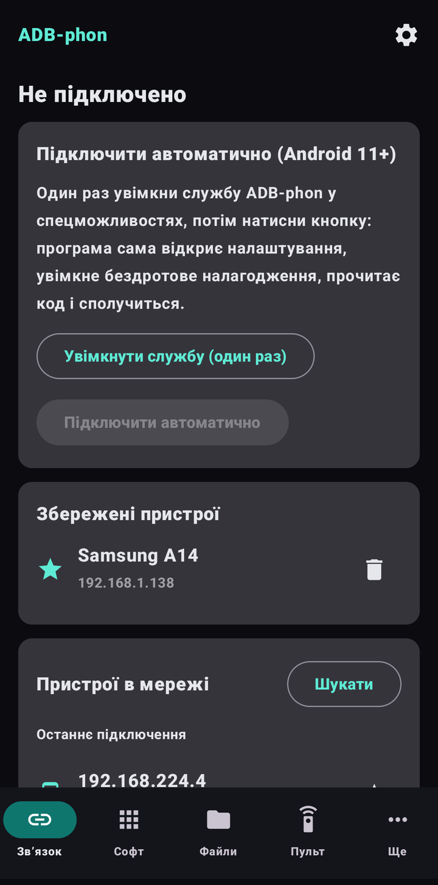

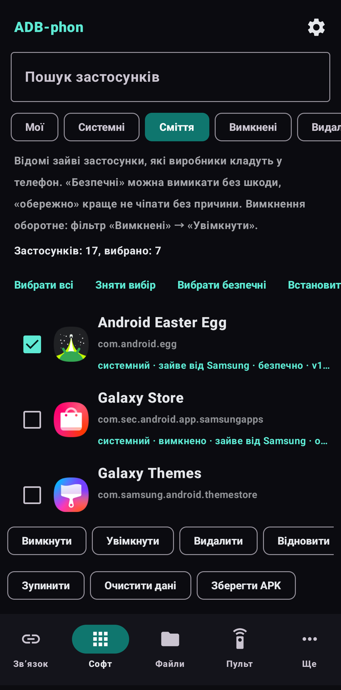

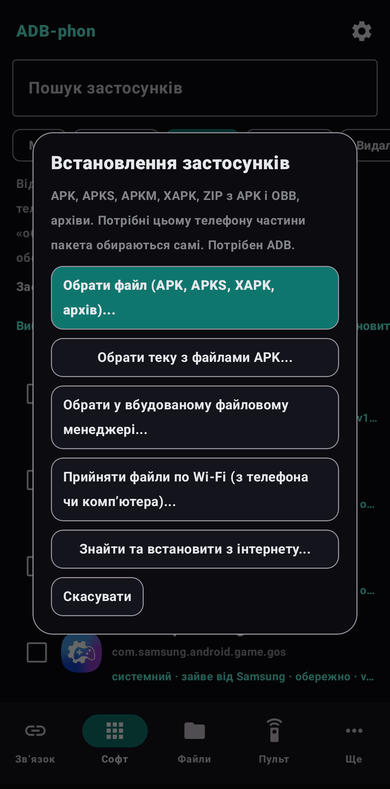

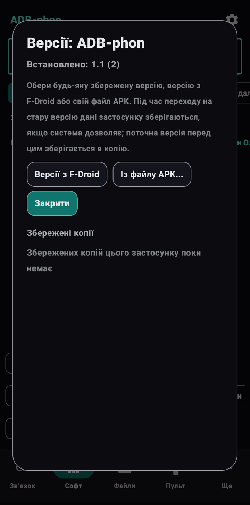

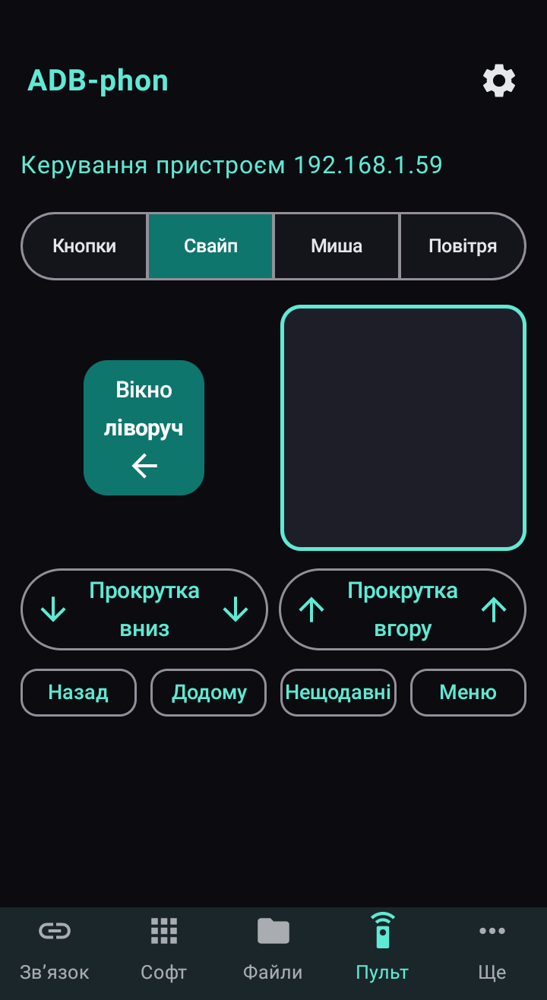

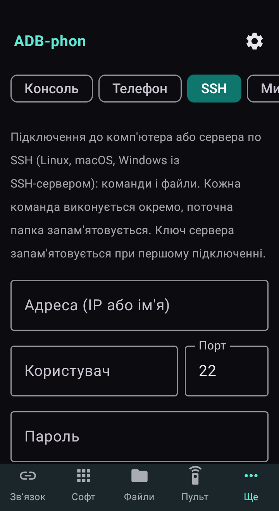

## Швидкий старт

1. Завантажте ADB-phon-2.0.apk і встановіть його (якщо Android запитає, дозвольте встановлення з цього джерела).
2. Android 11 і новіше: «Налаштування» → «Для розробників» → увімкніть «Бездротове налагодження» → «Підключення пристрою за допомогою коду». Відкрийте ADB-phon у розділеному екрані або плаваючому вікні, введіть порт і код, натисніть «Сполучення», потім «Підключитись».
3. Android 8–10: один раз з комп’ютера по USB виконайте adb tcpip 5555. В ADB-phon натисніть «Підключитись» і дозвольте налагодження на телефоні.
4. Для іншого пристрою (телевізор, другий телефон) натисніть його у списку «Пристрої в мережі» або введіть IP.

## Вимоги

Android 8.0 і новіше (ARMv7, ARM64, x86, x86_64). Для бездротового налагодження (Android 11+) потрібен Wi-Fi. Android 8–10: один раз команда з комп’ютера (adb tcpip 5555), після перезавантаження повторити. Перевірено на Android 10 (Samsung A7, S9), Android 15 (Samsung A14) та на ТВ-приставці з Android 11.

## Обмеження та попередження

- Дії над системними застосунками можуть зламати телефон: будьте обережні, програма просить підтвердження й захищає критичні пакети.
- ADB-phon працює локально й нічого нікуди не надсилає. Помічник із курсором і пульт керують пристроєм цілком: підключайтеся лише до своїх пристроїв.
- У Google Play програми немає (такого там не дозволено): завантажуйте APK тут. Android може попередити про встановлення з невідомого джерела.
- Перевірено на двох телефонах (Android 10 і 15) та одній ТВ-приставці (Android 11). На Android 8–9 та 11–14 інших виробників поки не перевірялося, відгуки вітаються.
- SSH і «Миша ПК» нові й перевірені частково: SSH — на сумісність з OpenSSH для Windows до етапу пароля; Bluetooth-миша є не на всіх телефонах (частина прошивок вимикає профіль HID).
- Особливі права на Xiaomi, Huawei та інших прошивках можуть відрізнятися; на Xiaomi увімкніть ще «Налагодження по USB (налаштування безпеки)».

## На чому зроблена

Kotlin і Jetpack Compose; ADB-клієнт libadb-android (MuntashirAkon, GPL-3.0 або Apache-2.0) і Conscrypt (Apache-2.0). Програма незалежна й не пов’язана з Google. Ліцензія GPL-3.0.

## Новини та допомога

- Telegram: [t.me/PhoneInWindowSound](https://t.me/PhoneInWindowSound)

## Підтримати проєкт

Програма безкоштовна. Якщо вона вам корисна, можна підтримати розробку банківською карткою, Google Pay або USDT. Для USDT лише мережа TRON (TRC20): монети, надіслані іншою мережею, втрачаються.

- Карткою або Google Pay (від 50 грн): https://secure.wayforpay.com/button/bba92579a4647
- USDT (TRON TRC20): `TXk32CLkwJryTqhmkw6urcM5CacJgPsSpJ`
