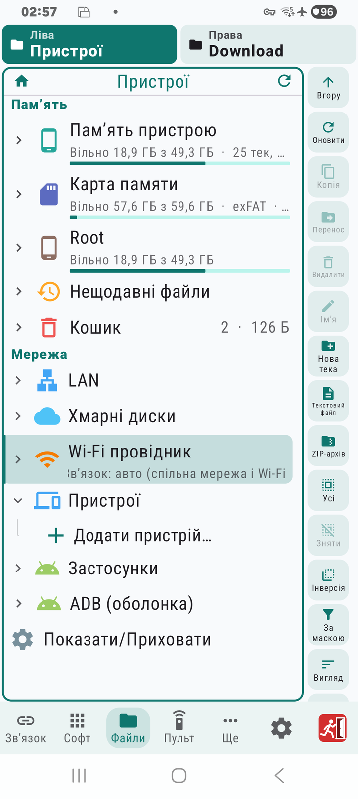
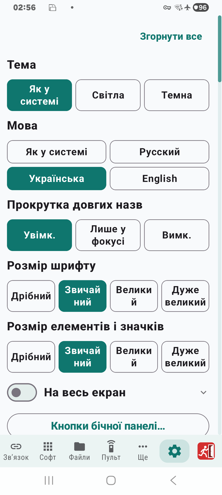
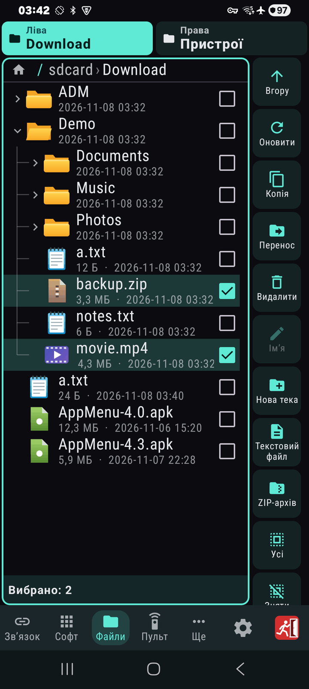
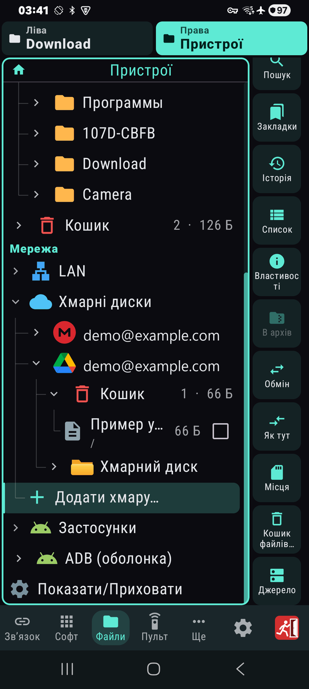
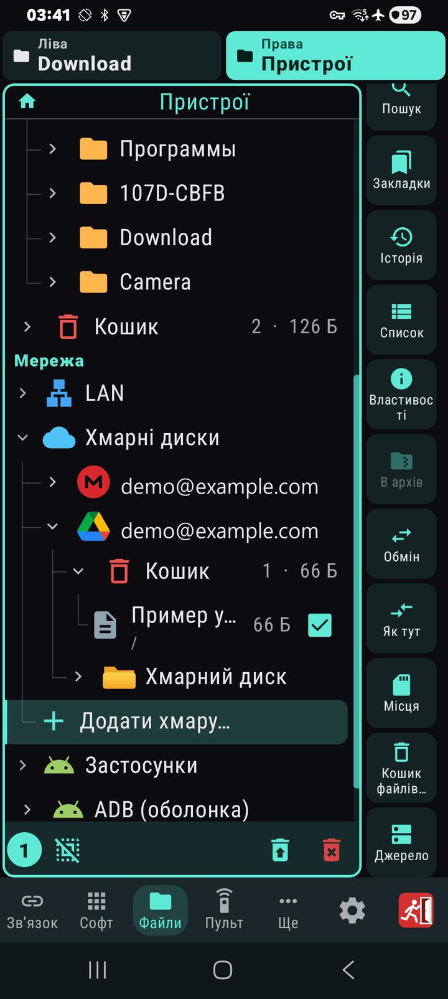
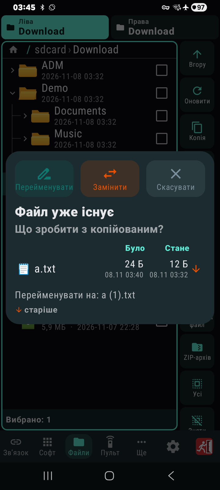
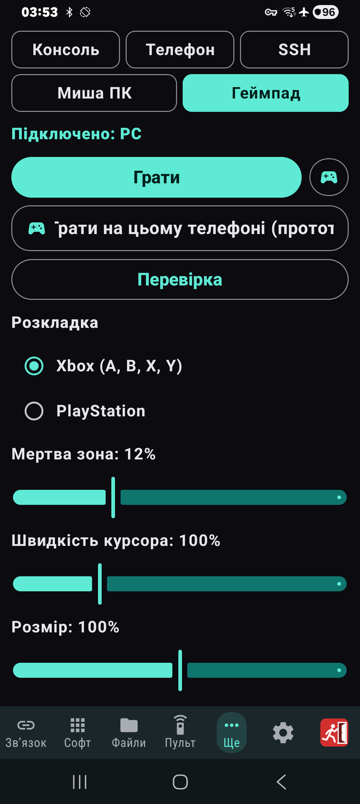
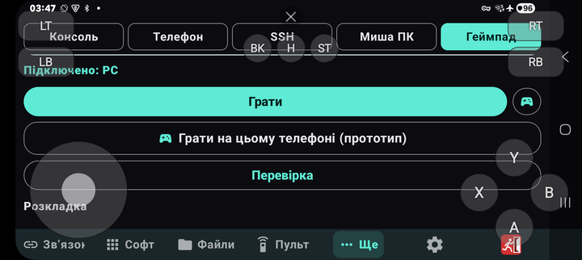
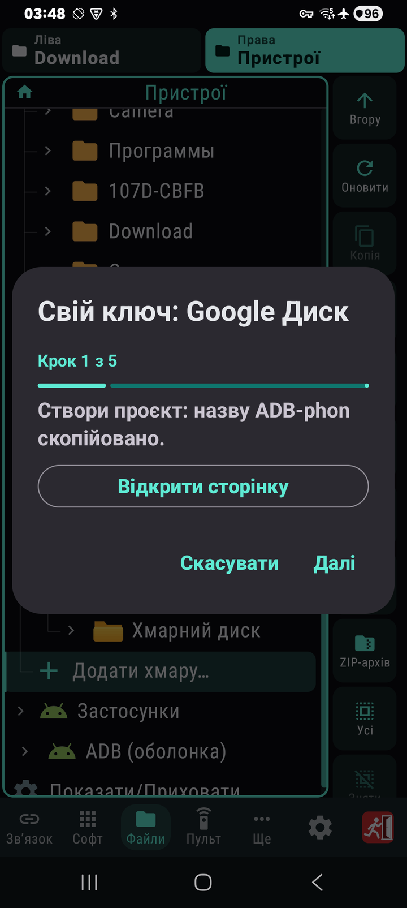
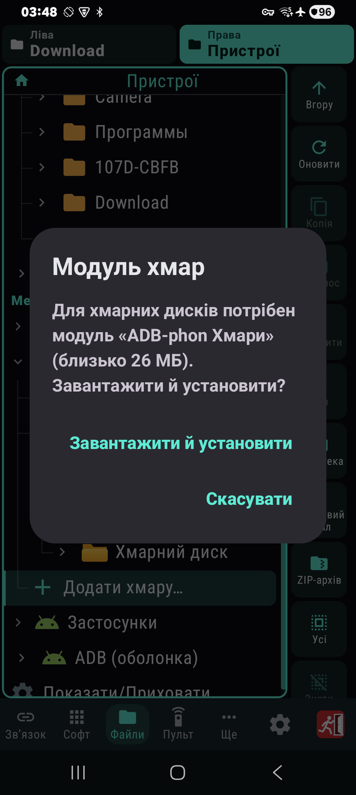

[English](README.md) · [Русский](README.ru.md) · [Українська](README.uk.md)

🌐 Усі наші програми: https://drugoj00.github.io/

📖 Повна інструкція до всіх функцій: [INSTRUCTION.uk.md](INSTRUCTION.uk.md)

# ADB-phon

Безкоштовний ADB-менеджер прямо на телефоні: встановлення APK через ADB, аеромиша й пульт, особливі права, що переживають перезавантаження. Без комп’ютера, root не обов’язковий (з root не потрібен навіть ADB).

ADB-phon підключається до ADB цього ж телефона (або іншого пристрою в мережі) і виконує команди з правами оболонки, наче телефон підключено до комп’ютера.

⭐ Якщо програма корисна, поставте зірку цьому репозиторію: це нічого не коштує й допомагає іншим її знайти.

## Завантажити

**Версія 8.0.** [ADB-phon-8.0.apk](https://github.com/drugoj00/adb-phon/releases/latest) (Assets) · [Releases](https://github.com/drugoj00/adb-phon/releases)

SHA-256: `85b000f51ca04ae436ddff3bd500739c87744b299a49a155fffe074be70a8bef`

## Що нового в 8.0

- Встановлення: вибір засобу встановлення в усіх місцях («Файли», хмари, мережеві теки, архіви, ADB-оболонка), перемикач «Питати, чим встановлювати»; з вікна «Встановлення» можна піти «У фоні», хід і підсумок у сповіщенні
- Модуль «ADB-phon Хмари» 1.2 без значка в списку застосунків; оновлення й видалення через вікно «Встановлення»
- Пристрої: рядки «Відеодзвінок», «Аудіодзвінок», «Вікно пристрою», «Файли», те саме в меню довгого натискання
- Дзвінок: дзеркальне власне зображення, поворот, запис відео й звуку, знімок екрана, підгонка вікна, вибір мікрофона й динаміка
- Вікно дзвінка на широкому екрані: картинка й колонка кнопок, колонка ліворуч або праворуч за налаштуванням «Панелі керування»; «На весь екран» без кнопок
- Віконце (картинка в картинці) за кнопкою й за «Додому» з кнопками завершення, запису та знімка; «Сховати, дзвінок триває»
- Мелодії дзвінка: 8 вбудованих, «Без звуку», гучність, попереднє прослуховування, гудок очікування
- «Моя аватарка»: аватарка співрозмовника або літера замість відео
- Слабкі приставки: приймач сам просить у співрозмовника 320×240, якщо кадри не розшифровуються
- Додано кореневі сертифікати для старих Android
- root запитується один раз за сеанс: постійна оболонка замість запуску su на кожну команду

## Можливості

- **Встановлення APK через ADB.** Встановлення й оновлення застосунків через ADB, комп’ютер не потрібен. Джерела: файл, тека, архів (ZIP, 7z, RAR, TAR), вбудований файловий менеджер (зокрема флешки через ADB), мережеві теки (SMB), приймання файлів по Wi‑Fi з браузера, пошук в інтернеті (F-Droid, GitHub, посилання). Пакети з кількох частин APKS, APKM, XAPK і ZIP з APK та OBB: потрібні частини для вашого телефона обираються самі. Пакетне встановлення.
- **Аеромиша та миша.** Гіроскоп телефона працює як указка. На екрані керованого пристрою з’являється справжній курсор (помічник створює віртуальну мишу). Кнопка «Повітря» працює у двох режимах, які обираються круглим перемикачем: торкнутися, щоб увімкнути, і ще раз, щоб вимкнути, або тримати, поки водиш телефоном. Клік, прокручування, ОК, Назад, Додому, Меню, стрілки, гучність, звук і мікрофон увімк/вимк. Дотик теж миттєвий: помічник надсилає справжні дотики, тому тапи й свайпи працюють навіть на слабких ТВ-приставках.
- **Особливі права, переживають перезавантаження.** Увімкнення служби спецможливостей, утримання її після перезавантаження (на Android 13–14 вона часто вимикається сама), зняття «обмежених налаштувань», запис захищених налаштувань, поверх інших вікон, сповіщення, статистика, усі файли, встановлення з невідомих джерел, без обмежень батареї.
- **Пульт.** Чотири режими перемикачем: Кнопки, Свайп, Миша, Повітря. Додому, назад, меню, хрестовина й ОК, гучність, медіа-кнопки, живлення, останні, введення тексту. Свайпи = стрілки, дотик = ОК, кнопки прокручування. Кнопки спрацьовують миттєво. Для телефонів, телевізорів і приставок.
- **SSH.** Підключення до комп’ютера або сервера по SSH (Linux, macOS, Windows із SSH-сервером): термінал і файли по SFTP (перегляд, завантажити, вивантажити, видалити). Вхід за паролем або файлом ключа; ключ сервера запам’ятовується під час першого підключення.
- **Миша ПК.** Телефон працює як Bluetooth-миша й клавіатура для комп’ютера, ноутбука, планшета, iPhone або телевізора (Android 9+): тачпад, кліки, прокручування, Enter, Esc, стрілки, Win, Ctrl+C/V, введення тексту. На комп’ютер нічого ставити не потрібно.
- **Просте підключення.** Автопошук пристроїв у мережі з іменами, обрані з вашими назвами, ручне введення IP. Android 11+: автоматичне сполучення без введення коду (служба спецможливостей сама читає код у системному вікні) або сполучення за кодом. Android 8–10: один раз команда з комп’ютера, далі програма підключається сама. Керування іншим пристроєм за IP; довге натискання на пристрій відключає його.
- **Застосунки.** Значки, пошук, фільтри (мої, системні, сміття, вимкнені, видалені), вимкнути й увімкнути, видалити й відновити, зупинити, очистити дані, зберегти APK, дозволи перемикачами, пакетні дії (зокрема пакетне видалення), захист критичних пакетів, кнопка «Очистити ОЗП».
- **Чистильник зайвого.** Фільтр «Сміття» показує відомі непотрібні системні застосунки (Samsung, Google, Microsoft, служби Facebook, партнерські) з позначками «безпечно» та «обережно». «Обрати безпечні» і вимкнути; це оборотно («Вимкнені» → «Увімкнути»).
- **Копії та версії.** Перед видаленням застосунку його APK зберігається. Кнопка «Версії» встановлює будь-яку версію, зокрема стару, зі збережених копій, з F-Droid або зі свого файлу.
- **Копія з даними.** Копія будь-якого застосунку разом із його даними та відновлення. З root зберігаються всі дані, через ADB лише те, що дозволяє система (зовнішні дані та, якщо застосунок дозволяє, внутрішні на Android 10 і старше). Системне вікно підтвердження програма натискає сама.
- **Захист головного екрана.** Єдиний головний екран не можна вимкнути або видалити помилково: якщо запасного немає, програма пропонує завантажити «Меню застосунків» з GitHub і ставить його одним натисканням (потрібен інтернет).
- **Оновлення.** Перевіряє GitHub на нову версію за кнопкою й пропонує оновитися одним натисканням; у налаштуваннях можна ввімкнути автоматичну перевірку раз на добу (за замовчуванням вимкнена).
- **Файли.** Двопанельний файловий менеджер: пам’ять телефона, карта пам’яті, USB-накопичувачі, архіви (ZIP, 7z, RAR, TAR), Android/data через ADB, мережеві теки й хмарні диски в одному дереві. Створити, перейменувати, копіювати, перемістити, видалити, ZIP, текстові файли, вбудований редактор, вибір за маскою, перетягування між панелями, кошик для телефона, карти, хмар і мережевих тек, вікно «Файл уже існує» («Перейменувати», «Замінити», «Скасувати», «Застосувати до всіх»). Після перезапуску повертаються теки й місця.
- **Хмарні диски.** Google Диск, MEGA, Dropbox, OneDrive, Яндекс Диск, Box, pCloud та десятки інших сервісів. Хмари працюють через окремий безкоштовний модуль «ADB-phon Хмари»: його пропонується завантажити один раз, коли додається хмара; завантажений файл після встановлення видаляється сам. Вхід у браузері; якщо спільний ключ програми зайнятий, майстер «Власний ключ» покроково допоможе створити свій.
- **Мережеві теки.** SMB, SFTP, FTP, FTPS і WebDAV: перегляд, копіювання й переміщення в обидва боки, зокрема напряму між двома мережевими джерелами та з хмари в мережу. Файл пишеться безпечно: оригінал не зникає при збої чи скасуванні.
- **Геймпад.** Телефон як геймпад для ПК через Bluetooth (вібрація з ПК) та екранний геймпад «Грати на цьому телефоні» (прототип): стики, A/B/X/Y, курки, Back, Guide і Start поверх будь-якої гри; розкладку, мертву зону, розмір і прозорість можна змінювати.
- **Телефон.** Відомості про пристрій, моніторинг, знімок і запис екрана, очищення кешу всіх застосунків, швидкі налаштування (темна тема, Wi-Fi, дані, Bluetooth, автоповорот, шрифт, згасання екрана, показ дотиків, анімації, DPI), перезавантаження (звичайне, recovery, завантажувач).
- **Пристрої та Відеовікно.** У дереві «Файлів» одна група «Пристрої»: комп’ютери й Android-пристрої разом, у кожного теки «Файли» та «Відеовікно». «Відеовікно» показує екран комп’ютера або іншого Android і керує ним: автоповорот, введення тексту будь-якою мовою.
- **Відеодзвінок.** Відеодзвінок між Android-пристроями та комп’ютерами (Windows-програма «Телефон у вікні зі звуком» 4.0). Як подзвонити: відкрийте «Звʼязок → Відеодзвінки», натисніть «Додати людину…», впишіть імʼя й код його програми (XXXX-XXXX-XXXX; код є в програмі співрозмовника: на Windows у «Звʼязку через інтернет», на Android у цьому ж розділі), потім «Подзвонити». У співрозмовника зʼявиться вікно «Дзвонить…»; камера й мікрофон вмикаються, лише коли він натисне «Відповісти». Під час дзвінка кнопки «Звук», «Динамік», «Камера», «Завершити». Приймання дзвінків увімкнено за замовчуванням (значок у шторці), перемикач у тому ж розділі.
- **Віконце, мелодії, аватарки.** Під час дзвінка «Віконце» (картинка в картинці) і «Сховати, дзвінок триває», вибір мелодії вхідного дзвінка, «Моя аватарка», рядки «Відеодзвінок», «Аудіодзвінок», «Вікно пристрою» та «Файли» у кожного пристрою.
- **Запрошення.** Підключення до мережі Tailscale за запрошенням із ПК. Інший VPN вимикається на час сеансу звʼязку й повертається як був.
- **Сумісність із Shizuku.** Застосунки з підтримкою Shizuku отримують права shell через ADB-phon.
- **Консоль.** Живий термінал: будь-які команди оболонки, історія, Ctrl+C, Tab, «Мої команди».
- **Налаштування.** Тема (авто, світла, темна), динамічні кольори зі шпалер і основний колір, розмір шрифту й елементів, режим «На весь екран», налаштування кольору (основний колір, колір смужок, контраст смужок), власні значки тек, файлів, дисків, застосунків і кнопок бічної панелі, мова (українська, російська, англійська), тримати екран увімкненим, журнал для пошуку помилок, резервна копія й відновлення налаштувань у вибрану теку, встановлення будь-якої версії програми з GitHub.
- **Безкоштовно.** Без реклами, відкритий код.

## Скриншоти

## Відео

- [Геймпад: Android ↔ Android (Asphalt 9)](https://youtu.be/V30zZv2MmFM)
- [Геймпад: Android ↔ ПК (GTA 5)](https://youtu.be/OmIT5jgrWFw)

## Швидкий старт

1. Завантажте ADB-phon-7.0.apk і встановіть його (якщо Android запитає, дозвольте встановлення з цього джерела).
2. Android 11 і новіше: «Налаштування» → «Для розробників» → увімкніть «Бездротове налагодження» → «Підключення пристрою за допомогою коду». Відкрийте ADB-phon у розділеному екрані або плаваючому вікні, введіть порт і код, натисніть «Сполучення», потім «Підключитись».
3. Android 8–10: один раз з комп’ютера по USB виконайте adb tcpip 5555. В ADB-phon натисніть «Підключитись» і дозвольте налагодження на телефоні.
4. Для іншого пристрою (телевізор, другий телефон) натисніть його у списку «Пристрої в мережі» або введіть IP.

## Вимоги

Android 8.0 і новіше (ARMv7, ARM64, x86, x86_64). Для бездротового налагодження (Android 11+) потрібен Wi-Fi. Android 8–10: один раз команда з комп’ютера (adb tcpip 5555), після перезавантаження повторити. Перевірено на Android 10 (Samsung A7, S9), Android 15 (Samsung A14) та на ТВ-приставках з Android 9, 11 і 12. Root у «Файлах»: з root (su) відкривається все і змінюються права доступу; через ADB без root доступні /system, Android/data і /data/local/tmp, а /data і права чужих файлів закриті самим Android.

## Обмеження та попередження

- Дії над системними застосунками можуть зламати телефон: будьте обережні, програма просить підтвердження й захищає критичні пакети.
- ADB-phon працює локально й нічого нікуди не надсилає. Помічник із курсором і пульт керують пристроєм цілком: підключайтеся лише до своїх пристроїв.
- У Google Play програми немає (такого там не дозволено): завантажуйте APK тут. Android може попередити про встановлення з невідомого джерела.
- Перевірено на трьох телефонах (Android 10 і 15) та ТВ-приставках (Android 9, 11, 12). На Android 8 і на пристроях x86 поки не перевірялося, відгуки вітаються.
- Для хмарних дисків потрібен окремий модуль «ADB-phon Хмари» (завантажується один раз, потрібен інтернет). Google Диск: спільний ключ програми пробний (перші 100 користувачів), далі створіть свій ключ у програмі. Архіви RAR5 підтримуються (зокрема з паролем). FTPS: перегляд і завантаження перевірено, вивантаження лише частково.
- SSH і «Миша ПК» нові й перевірені частково: SSH перевірено на сумісність з OpenSSH для Windows до етапу пароля; Bluetooth-миша є не на всіх телефонах (частина прошивок вимикає профіль HID).
- Особливі права на Xiaomi, Huawei та інших прошивках можуть відрізнятися; на Xiaomi увімкніть ще «Налагодження по USB (налаштування безпеки)».
- Відеовікно за адресою Tailscale (100.x) працює, якщо обидва пристрої в мережі Tailscale (за постійного іншого VPN на телефоні потрібна адреса тієї самої мережі). Введення тексту у Відеовікні будь-якою розкладкою потребує ADB-phon 7.0 або новішого на цільовому пристрої.

## На чому зроблена

Kotlin і Jetpack Compose; ADB-клієнт libadb-android (MuntashirAkon, GPL-3.0 або Apache-2.0) і Conscrypt (Apache-2.0). Програма незалежна й не пов’язана з Google. Ліцензія GPL-3.0.

## Новини та допомога

- Telegram: [t.me/PhoneInWindowSound](https://t.me/PhoneInWindowSound)

## Підтримати проєкт

Програма безкоштовна. Якщо вона вам корисна, можна підтримати розробку банківською карткою, Google Pay або USDT. Для USDT лише мережа TRON (TRC20): монети, надіслані іншою мережею, втрачаються.

- Карткою або Google Pay (від 50 грн): https://secure.wayforpay.com/button/bba92579a4647
- USDT (TRON TRC20): `TXk32CLkwJryTqhmkw6urcM5CacJgPsSpJ`
